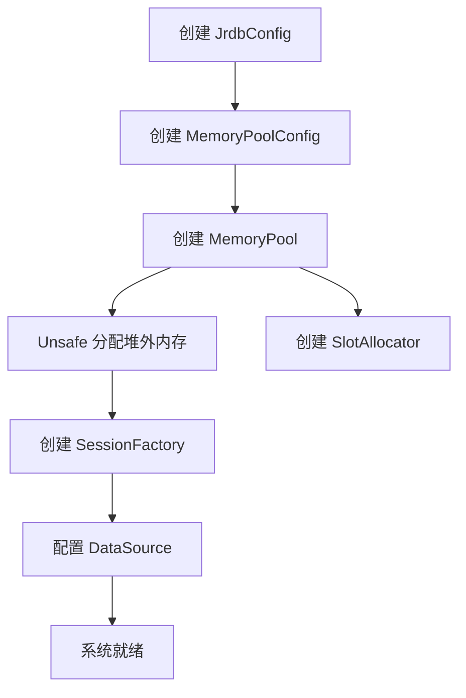
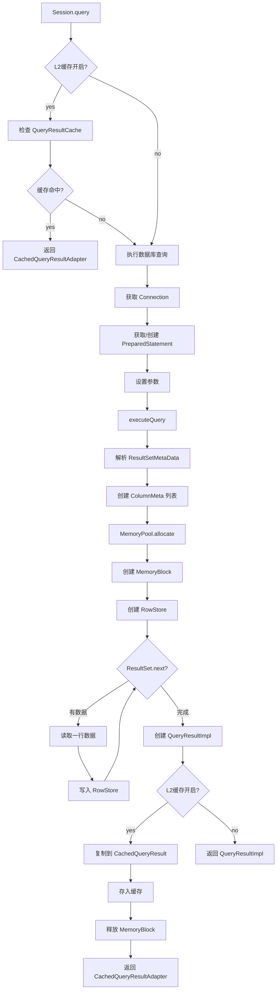
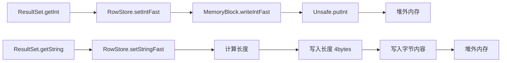
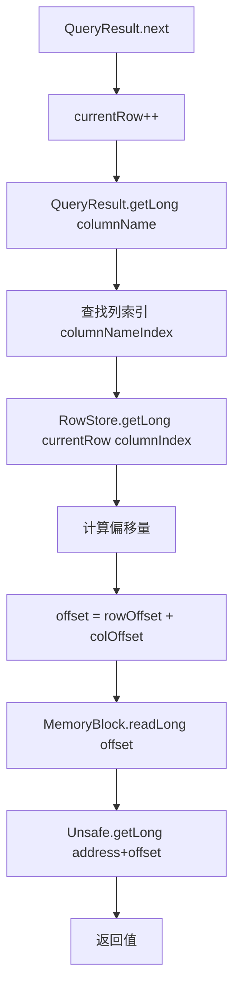
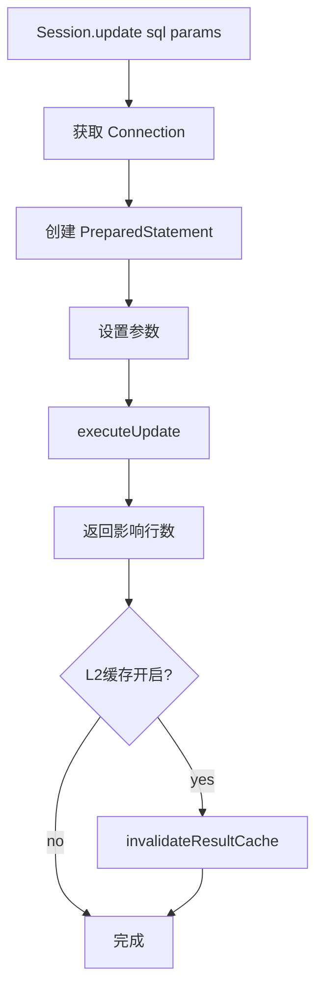
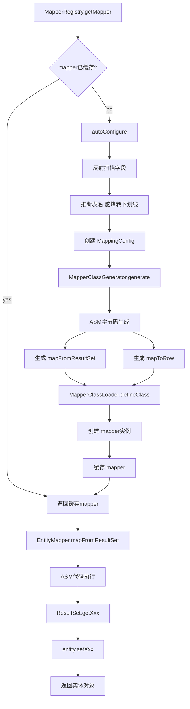
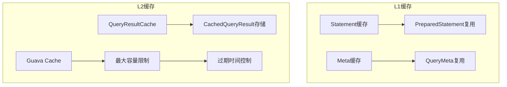
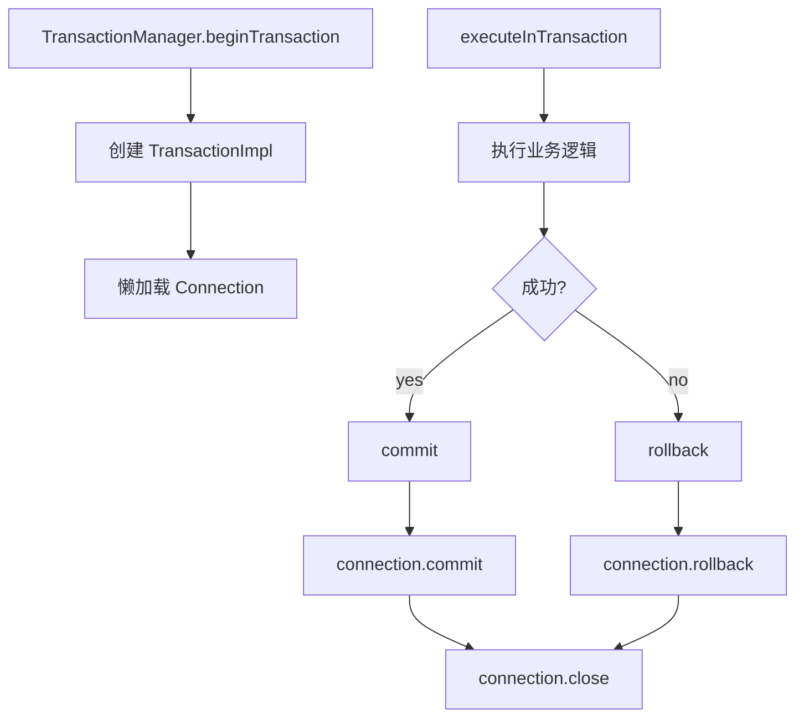

# jrdb 核心数据流图

## 概述

本文档描述 jrdb 项目中核心数据的流转过程，包括初始化、查询、更新、内存管理和实体映射等关键流程。

## 1. 初始化流程



**关键步骤说明：**
- `MemoryPoolConfig` 定义预分配内存大小（默认256MB）和查询缓存大小（默认16MB）
- `MemoryPool` 使用 `Unsafe.allocateMemory()` 分配堆外内存
- `SlotAllocator` 使用位图管理内存槽位的分配与释放

## 2. 查询流程



**数据写入细节：**


## 3. 数据读取流程



**内存布局示意：**
```
MemoryBlock 内存布局:
┌─────────────────────────────────────────────────────┐
│ Row0: [Col0][Col1][Col2]...[ColN]                   │
│ Row1: [Col0][Col1][Col2]...[ColN]                   │
│ Row2: [Col0][Col1][Col2]...[ColN]                   │
│ ...                                                 │
│ RowM: [Col0][Col1][Col2]...[ColN]                   │
└─────────────────────────────────────────────────────┘

offset = currentRow * rowSize + columnOffsets[columnIndex]
```

## 4. 更新流程



## 5. 内存管理流程

```mermaid
flowchart TD
    subgraph 分配流程
        A1[MemoryPool.allocate] --> A2[SlotAllocator.allocate]
        A2 --> A3[查找空闲slot]
        A3 --> A4[位图标记已使用]
        A4 --> A5[计算地址]
        A5 --> A6[创建 MemoryBlock]
    end
    
    subgraph 释放流程
        B1[MemoryPool.release] --> B2[SlotAllocator.release]
        B2 --> B3[位图标记未使用]
        B3 --> B4[更新 nextFreeSlot]
    end
    
    subgraph 销毁流程
        C1[MemoryPool.destroy] --> C2[Unsafe.freeMemory]
        C2 --> C3[释放堆外内存]
    end
```



**SlotAllocator 位图结构：**
```
slots: long[] 数组，每64个slot用一个long表示
位图位: 1 = 已使用, 0 = 未使用

示例（slotCount=128）:
slots[0]: |slot0|slot1|slot2|...|slot63|  (64 bits)
slots[1]: |slot64|slot65|...|slot127|     (64 bits)
```

## 6. 实体映射流程



**ASM 字节码生成示例：**
```java
// 生成的 mapFromResultSet 方法伪代码
public User mapFromResultSet(ResultSet rs) {
    User user = new User();
    user.setId(rs.getLong("id"));
    user.setName(rs.getString("name"));
    user.setAge(rs.getInt("age"));
    return user;
}
```

## 7. 缓存策略



**缓存级别说明：**
- `NONE`: 无缓存，每次创建新的 PreparedStatement
- `L1`: Statement 和 Meta 缓存，减少对象创建开销
- `L2`: 结果缓存，相同查询直接返回缓存结果

## 8. 事务流程



## 数据流总结

| 操作 | 数据流向 | 关键组件 |
|------|----------|----------|
| 查询 | DB → ResultSet → MemoryBlock → QueryResult | Session, RowStore, MemoryPool |
| 读取 | QueryResult → RowStore → MemoryBlock → Unsafe | 堆外内存直接读取 |
| 更新 | SQL → PreparedStatement → DB | Session, Connection |
| 映射 | ResultSet → ASM生成代码 → Entity | MapperRegistry, EntityMapper |
| 缓存 | QueryResult → CachedQueryResult → Cache | QueryResultCache, Guava Cache |