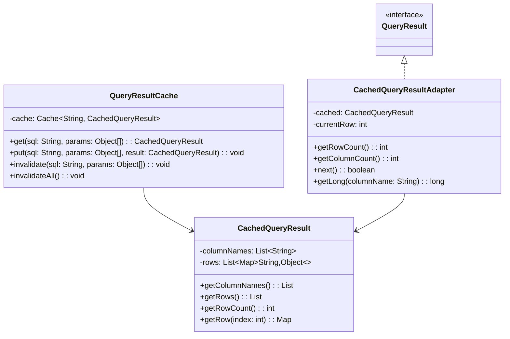
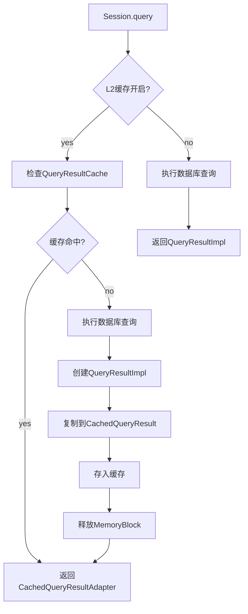
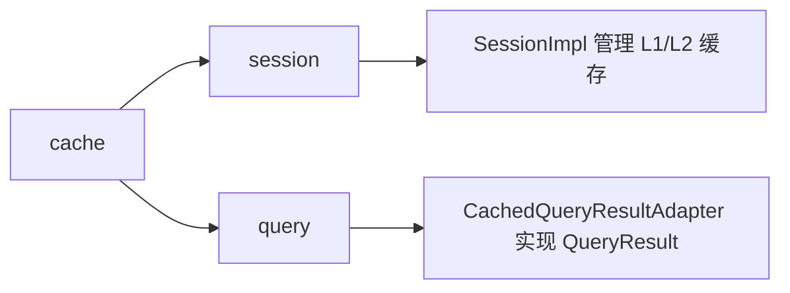

# cache 模块设计文档

## 概述

cache 模块提供查询结果缓存能力，支持 L1（Statement/Meta 缓存）和 L2（结果缓存）两级缓存。L2 缓存使用 Guava Cache 实现，提供容量限制和过期策略。

## 类结构



## 核心类详解

### QueryResultCache

L2 缓存管理类，基于 Guava Cache 实现。

```java
public class QueryResultCache {
    private final Cache<String, CachedQueryResult> cache;
    
    public QueryResultCache(int maxSize, int expireSeconds) {
        this.cache = CacheBuilder.newBuilder()
            .maximumSize(maxSize)
            .expireAfterWrite(expireSeconds, TimeUnit.SECONDS)
            .build();
    }
    
    public CachedQueryResult get(String sql, Object[] params) {
        String key = buildKey(sql, params);
        return cache.getIfPresent(key);
    }
    
    public void put(String sql, Object[] params, CachedQueryResult result) {
        String key = buildKey(sql, params);
        cache.put(key, result);
    }
    
    public void invalidate(String sql, Object[] params) {
        String key = buildKey(sql, params);
        cache.invalidate(key);
    }
    
    public void invalidateAll() {
        cache.invalidateAll();
    }
    
    private String buildKey(String sql, Object[] params) {
        if (params == null || params.length == 0) {
            return sql;
        }
        return sql + ":" + Arrays.hashCode(params);
    }
}
```

**设计要点：**
- `maximumSize`: 最大缓存条目数
- `expireAfterWrite`: 写入后过期时间
- Key 构建: SQL + 参数 hashCode

### CachedQueryResult

缓存查询结果，存储在堆内存中。

```java
public class CachedQueryResult {
    private final List<String> columnNames;
    private final List<Map<String, Object>> rows;
    
    public CachedQueryResult(List<String> columnNames, List<Map<String, Object>> rows) {
        this.columnNames = columnNames;
        this.rows = rows;
    }
    
    public int getRowCount() { return rows.size(); }
    
    public Map<String, Object> getRow(int index) {
        if (index < 0 || index >= rows.size()) return null;
        return rows.get(index);
    }
    
    public static class Builder {
        private List<String> columnNames = new ArrayList<>();
        private List<Map<String, Object>> rows = new ArrayList<>();
        
        public Builder addColumnName(String name) {
            columnNames.add(name);
            return this;
        }
        
        public Builder newRow() {
            rows.add(new HashMap<>());
            return this;
        }
        
        public Builder put(String column, Object value) {
            if (!rows.isEmpty()) {
                rows.get(rows.size() - 1).put(column.toUpperCase(), value);
            }
            return this;
        }
        
        public CachedQueryResult build() {
            return new CachedQueryResult(columnNames, rows);
        }
    }
}
```

**数据结构：**
```
CachedQueryResult:
┌──────────────────────────────────────────────────────────────┐
│ columnNames: ["ID", "NAME", "AGE"]                           │
├──────────────────────────────────────────────────────────────┤
│ rows:                                                        │
│   [0]: {ID: 1, NAME: "Alice", AGE: 30}                       │
│   [1]: {ID: 2, NAME: "Bob", AGE: 25}                         │
│   [2]: {ID: 3, NAME: "Charlie", AGE: 35}                     │
└──────────────────────────────────────────────────────────────┘
```

### CachedQueryResultAdapter

适配器，将 CachedQueryResult 转为 QueryResult 接口。

```java
public class CachedQueryResultAdapter implements QueryResult {
    private final CachedQueryResult cached;
    private int currentRow = -1;
    
    public CachedQueryResultAdapter(CachedQueryResult cached) {
        this.cached = cached;
    }
    
    @Override
    public int getRowCount() {
        return cached.getRowCount();
    }
    
    @Override
    public boolean next() {
        currentRow++;
        return currentRow < cached.getRowCount();
    }
    
    @Override
    public long getLong(String columnName) {
        Map<String, Object> row = cached.getRow(currentRow);
        if (row == null) return 0;
        Object val = row.get(columnName.toUpperCase());
        if (val instanceof Number) {
            return ((Number) val).longValue();
        }
        return 0;
    }
    
    @Override
    public void release() {
        // 无需释放，数据在堆内存
    }
    
    @Override
    public void close() {
        currentRow = -1;
    }
}
```

## 缓存层级

### L1 缓存

位于 SessionImpl 中，缓存 PreparedStatement 和 QueryMeta：

```java
// SessionImpl 中的 L1 缓存
private final Map<String, PreparedStatement> statementCache;
private final Map<String, QueryMeta> metaCache;

// 使用 LinkedHashMap 实现 LRU
private <K, V> Map<K, V> createLruCache(int maxSize) {
    return new LinkedHashMap<K, V>(maxSize, 0.75f, true) {
        @Override
        protected boolean removeEldestEntry(Map.Entry<K, V> eldest) {
            return size() > maxSize;
        }
    };
}
```

**L1 缓存作用：**
- PreparedStatement 复用，减少对象创建
- QueryMeta 复用，避免重复解析 ResultSetMetaData

### L2 缓存

缓存完整查询结果：



## 缓存配置

```java
DbMmapConfig config = DbMmapConfig.builder()
    .cacheLevel(CacheLevel.L2)       // 缓存级别
    .statementCacheSize(256)         // L1 Statement 缓存大小
    .resultCacheSize(1000)           // L2 结果缓存大小
    .resultCacheExpireSeconds(300)   // L2 过期时间（秒）
    .build();
```

**CacheLevel 说明：**
| 级别 | 缓存内容 | 适用场景 |
|------|----------|----------|
| NONE | 无缓存 | 数据频繁变化 |
| L1 | Statement + Meta | 查询频繁但结果变化 |
| L2 | 完整结果 | 相同查询重复执行 |

## 缓存失效

```java
// 数据更新后失效缓存
public void invalidateResultCache() {
    if (resultCache != null) {
        resultCache.invalidateAll();
    }
}

// SessionImpl 在更新时调用
public int update(String sql, Object... params) {
    // ... 执行更新
    invalidateResultCache();  // 失效所有缓存
    return result;
}
```

**设计考虑：**
- 更新操作后失效所有缓存（保守策略）
- 未来可优化为失效相关表的缓存

## 内存对比

| 实现 | 数据位置 | 内存管理 | 性能 |
|------|----------|----------|------|
| QueryResultImpl | 堆外 MemoryBlock | 需显式释放 | 直接内存访问 |
| CachedQueryResult | 堆内存 Map | GC 管理 | 对象访问 |

**L2 缓存的权衡：**
- 优势：避免重复查询数据库，响应更快
- 劣势：占用堆内存，GC 压力增加

## 使用示例

```java
// 配置 L2 缓存
DbMmapConfig config = DbMmapConfig.builder()
    .cacheLevel(CacheLevel.L2)
    .resultCacheSize(1000)
    .resultCacheExpireSeconds(300)
    .build();

SessionFactory factory = new SessionFactory(config, dataSource);
Session session = factory.openSession();

// 第一次查询：执行数据库查询，缓存结果
QueryResult result1 = session.query("SELECT * FROM user WHERE id = ?", 1);

// 第二次查询：直接返回缓存
QueryResult result2 = session.query("SELECT * FROM user WHERE id = ?", 1);

// 更新操作：失效缓存
session.update("UPDATE user SET name = ? WHERE id = ?", "NewName", 1);

// 再次查询：重新执行数据库查询
QueryResult result3 = session.query("SELECT * FROM user WHERE id = ?", 1);

// 手动清理缓存
session.invalidateResultCache();
session.clearCache();  // 清理 L1 + L2
```

## 与其他模块的关系

