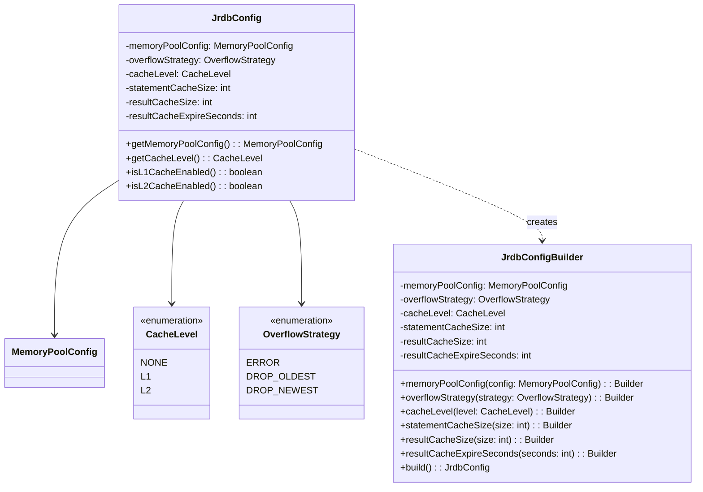
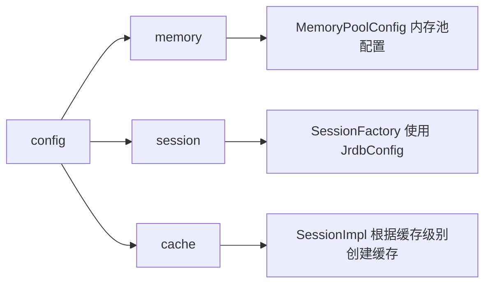

# config 模块设计文档

## 概述

config 模块负责全局配置管理，包括内存池配置、缓存级别、溢出策略等。使用 Builder 模式提供灵活的配置方式。

## 类结构



## 核心类详解

### JrdbConfig

全局配置类，不可变对象。

```java
public class JrdbConfig {
    private final MemoryPoolConfig memoryPoolConfig;
    private final OverflowStrategy overflowStrategy;
    private final CacheLevel cacheLevel;
    private final int statementCacheSize;
    private final int resultCacheSize;
    private final int resultCacheExpireSeconds;
    
    private JrdbConfig(Builder builder) {
        this.memoryPoolConfig = builder.memoryPoolConfig;
        this.overflowStrategy = builder.overflowStrategy;
        this.cacheLevel = builder.cacheLevel;
        this.statementCacheSize = builder.statementCacheSize;
        this.resultCacheSize = builder.resultCacheSize;
        this.resultCacheExpireSeconds = builder.resultCacheExpireSeconds;
        validate();
    }
    
    private void validate() {
        if (memoryPoolConfig == null) {
            throw new NullPointerException("memoryPoolConfig cannot be null");
        }
        if (statementCacheSize < 0) {
            throw new IllegalArgumentException("statementCacheSize must be non-negative");
        }
        if (resultCacheSize < 0) {
            throw new IllegalArgumentException("resultCacheSize must be non-negative");
        }
    }
    
    public boolean isL1CacheEnabled() {
        return cacheLevel == CacheLevel.L1 || cacheLevel == CacheLevel.L2;
    }
    
    public boolean isL2CacheEnabled() {
        return cacheLevel == CacheLevel.L2;
    }
}
```

### JrdbConfig.Builder

Builder 模式构建配置。

```java
public static class Builder {
    private MemoryPoolConfig memoryPoolConfig = MemoryPoolConfig.builder().build();
    private OverflowStrategy overflowStrategy = OverflowStrategy.ERROR;
    private CacheLevel cacheLevel = CacheLevel.L1;
    private int statementCacheSize = 256;
    private int resultCacheSize = 1000;
    private int resultCacheExpireSeconds = 300;
    
    public Builder memoryPoolConfig(MemoryPoolConfig memoryPoolConfig) {
        this.memoryPoolConfig = memoryPoolConfig;
        return this;
    }
    
    public Builder cacheLevel(CacheLevel cacheLevel) {
        this.cacheLevel = cacheLevel;
        return this;
    }
    
    public JrdbConfig build() {
        return new JrdbConfig(this);
    }
}
```

**默认值说明：**
| 配置项 | 默认值 | 说明 |
|--------|--------|------|
| memoryPoolConfig | 256MB/16MB | 预分配内存/槽位大小 |
| overflowStrategy | ERROR | 内存溢出时报错 |
| cacheLevel | L1 | Statement 缓存开启 |
| statementCacheSize | 256 | Statement 缓存容量 |
| resultCacheSize | 1000 | L2 缓存容量 |
| resultCacheExpireSeconds | 300 | L2 缓存过期时间 |

### CacheLevel

缓存级别枚举。

```java
public enum CacheLevel {
    NONE,   // 无缓存
    L1,     // Statement + Meta 缓存
    L2      // 结果缓存（含 L1）
}
```

### OverflowStrategy

内存溢出策略枚举。

```java
public enum OverflowStrategy {
    ERROR,       // 抛出异常
    DROP_OLDEST, // 丢弃最旧的数据
    DROP_NEWEST  // 丢弃最新的数据
}
```

**当前实现：**
- `ERROR` 已实现，抛出 `IllegalStateException`
- `DROP_OLDEST/DROP_NEWEST` 为未来扩展预留

## 配置项详解

### memoryPoolConfig

内存池配置，控制堆外内存分配：

```java
MemoryPoolConfig poolConfig = MemoryPoolConfig.builder()
    .preAllocMemSize(512 * 1024 * 1024)  // 512MB 预分配
    .queryCacheSize(32 * 1024 * 1024)    // 32MB 槽位大小
    .build();
```

### cacheLevel

控制缓存行为：

```java
// 无缓存：每次创建新对象
config.cacheLevel(CacheLevel.NONE)

// L1 缓存：复用 PreparedStatement
config.cacheLevel(CacheLevel.L1)

// L2 缓存：复用查询结果
config.cacheLevel(CacheLevel.L2)
```

### statementCacheSize

L1 Statement 缓存容量：

```java
config.statementCacheSize(512)  // 最多缓存 512 个 Statement
```

### resultCacheSize / resultCacheExpireSeconds

L2 缓存容量和过期时间：

```java
config.resultCacheSize(2000)           // 最多缓存 2000 个结果
config.resultCacheExpireSeconds(600)   // 10 分钟过期
```

## 使用示例

```java
// 基本配置
JrdbConfig config = JrdbConfig.builder()
    .cacheLevel(CacheLevel.L2)
    .build();

// 详细配置
JrdbConfig config = JrdbConfig.builder()
    .memoryPoolConfig(MemoryPoolConfig.builder()
        .preAllocMemSize(512 * 1024 * 1024)
        .queryCacheSize(32 * 1024 * 1024)
        .build())
    .overflowStrategy(OverflowStrategy.ERROR)
    .cacheLevel(CacheLevel.L2)
    .statementCacheSize(512)
    .resultCacheSize(2000)
    .resultCacheExpireSeconds(600)
    .build();

// 创建 SessionFactory
SessionFactory factory = new SessionFactory(config, dataSource);
```

## 与其他模块的关系

