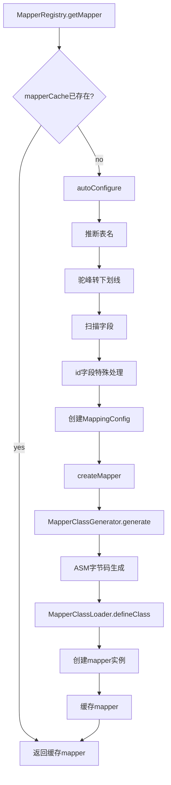
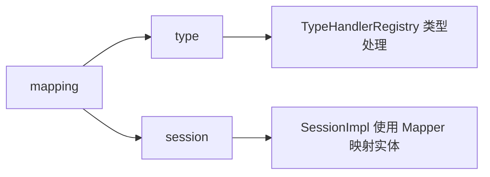

# mapping 模块设计文档

## 概述

mapping 模块负责 Java 实体类与数据库表之间的映射关系管理。通过 ASM 动态生成字节码，实现高性能的对象映射，避免反射开销。

## 类结构

```mermaid
classDiagram
    interface EntityMapper~T~ {
        +mapFromResultSet(rs: ResultSet): T
        +mapToRow(entity: T): Object[]
    }
    
    class MapperRegistry {
        -typeHandlerRegistry: TypeHandlerRegistry
        -classLoader: MapperClassLoader
        -generator: MapperClassGenerator
        -mapperCache: Map
        -configCache: Map
        +getMapper(entityClass: Class~T~): EntityMapper~T~
        +register(config: MappingConfig): EntityMapper~T~
        +hasMapper(entityClass: Class): boolean
    }
    
    class MapperClassGenerator {
        +generate(config: MappingConfig): byte[]
        +getGeneratedClassName(config: MappingConfig): String
    }
    
    class MapperClassLoader {
        +defineClass(name: String, bytecode: byte[]): Class
    }
    
    class MappingConfig {
        -entityClass: Class
        -tableName: String
        -typeHandlerRegistry: TypeHandlerRegistry
        -nameStrategy: NameStrategy
        -fields: List~MappingField~
        +field(fieldName: String, javaType: Class): MappingConfig
        +idField(fieldName: String, javaType: Class): MappingConfig
    }
    
    class MappingField {
        -fieldName: String
        -columnName: String
        -javaType: Class
        -typeHandler: TypeHandler
        -id: boolean
        +id(): MappingField
        +typeHandler(handler: TypeHandler): MappingField
    }
    
    interface NameStrategy {
        +fieldNameToColumnName(fieldName: String): String
    }
    
    class DefaultNameStrategy {
        +fieldNameToColumnName(fieldName: String): String
    }
    
    EntityMapper <|.. ASMGeneratedMapper
    MapperRegistry --> TypeHandlerRegistry
    MapperRegistry --> MapperClassGenerator
    MapperRegistry --> MapperClassLoader
    MapperClassGenerator --> MappingConfig
    MapperClassGenerator ..> EntityMapper : generates
    MappingConfig --> MappingField
    MappingConfig --> NameStrategy
    NameStrategy <|.. DefaultNameStrategy
```

## 核心类详解

### EntityMapper 接口

定义实体映射的基本契约。

```java
public interface EntityMapper<T> {
    T mapFromResultSet(ResultSet rs) throws SQLException;
    Object[] mapToRow(T entity);
}
```

**设计要点：**
- `mapFromResultSet`: 从 ResultSet 映射到实体对象
- `mapToRow`: 从实体对象映射到参数数组

### MapperRegistry

映射器注册中心，管理和缓存 EntityMapper。

```java
public class MapperRegistry {
    private final TypeHandlerRegistry typeHandlerRegistry;
    private final MapperClassLoader classLoader;
    private final MapperClassGenerator generator;
    private final Map<Class<?>, EntityMapper<?>> mapperCache = new ConcurrentHashMap<>();
    private final Map<Class<?>, MappingConfig> configCache = new ConcurrentHashMap<>();
    
    public <T> EntityMapper<T> getMapper(Class<T> entityClass) {
        return (EntityMapper<T>) mapperCache.computeIfAbsent(entityClass, this::createMapper);
    }
    
    public <T> EntityMapper<T> register(MappingConfig config) {
        EntityMapper<?> mapper = createMapper(config);
        mapperCache.put(config.getEntityClass(), mapper);
        configCache.put(config.getEntityClass(), config);
        return (EntityMapper<T>) mapper;
    }
}
```

**设计要点：**
- `ConcurrentHashMap` 缓存，支持并发访问
- `computeIfAbsent` 确保每个类只生成一次 mapper
- 支持手动注册和自动配置

### MapperClassGenerator

ASM 字节码生成器，动态创建 Mapper 类。

```java
public class MapperClassGenerator {
    private static final String ENTITY_MAPPER_INTERFACE = "com/jrdb/core/mapping/EntityMapper";
    private static final int ASM_VERSION = Opcodes.ASM9;
    
    public byte[] generate(MappingConfig config) {
        String className = getGeneratedClassNameInternal(config);
        String entityClassName = Type.getInternalName(config.getEntityClass());
        
        ClassWriter cw = new ClassWriter(ClassWriter.COMPUTE_FRAMES | ClassWriter.COMPUTE_MAXS);
        
        cw.visit(Opcodes.V1_8, 
                Opcodes.ACC_PUBLIC | Opcodes.ACC_SUPER,
                className, null, "java/lang/Object",
                new String[]{ENTITY_MAPPER_INTERFACE});
        
        generateConstructor(cw, className);
        generateMapFromResultSet(cw, className, config, entityClassName);
        generateMapToRow(cw, className, config, entityClassName);
        
        cw.visitEnd();
        return cw.toByteArray();
    }
}
```

#### mapFromResultSet 生成逻辑

```java
private void generateMapFromResultSet(ClassWriter cw, MappingConfig config, String entityClassName) {
    MethodVisitor mv = cw.visitMethod(Opcodes.ACC_PUBLIC, "mapFromResultSet",
            "(Ljava/sql/ResultSet;)Ljava/lang/Object;", null, null);
    
    mv.visitCode();
    
    // 创建实体实例
    mv.visitTypeInsn(Opcodes.NEW, entityClassName);
    mv.visitInsn(Opcodes.DUP);
    mv.visitMethodInsn(Opcodes.INVOKESPECIAL, entityClassName, "<init>", "()V", false);
    mv.visitVarInsn(Opcodes.ASTORE, 2);
    
    // 遍历字段，设置值
    for (MappingField field : config.getFields()) {
        String setterName = getSetterName(field.getFieldName());
        
        mv.visitVarInsn(Opcodes.ALOAD, 2);  // 加载实体
        mv.visitVarInsn(Opcodes.ALOAD, 1);  // 加载 ResultSet
        mv.visitLdcInsn(field.getColumnName());
        
        // 根据 Java 类型调用对应的 ResultSet.getXxx 方法
        if (field.getJavaType() == int.class) {
            mv.visitMethodInsn(Opcodes.INVOKEINTERFACE, "java/sql/ResultSet",
                    "getInt", "(Ljava/lang/String;)I", true);
            mv.visitMethodInsn(Opcodes.INVOKEVIRTUAL, entityClassName,
                    setterName, "(I)V", false);
        } else if (field.getJavaType() == long.class) {
            mv.visitMethodInsn(Opcodes.INVOKEINTERFACE, "java/sql/ResultSet",
                    "getLong", "(Ljava/lang/String;)J", true);
            mv.visitMethodInsn(Opcodes.INVOKEVIRTUAL, entityClassName,
                    setterName, "(J)V", false);
        }
        // ... 其他类型
    }
    
    mv.visitVarInsn(Opcodes.ALOAD, 2);
    mv.visitInsn(Opcodes.ARETURN);
    mv.visitMaxs(3, 4);
    mv.visitEnd();
}
```

**生成的代码示例：**
```java
// 对于 User 类，生成的 Mapper 类似于：
public class UserMapper implements EntityMapper<User> {
    public User mapFromResultSet(ResultSet rs) throws SQLException {
        User user = new User();
        user.setId(rs.getLong("id"));
        user.setName(rs.getString("name"));
        user.setAge(rs.getInt("age"));
        return user;
    }
    
    public Object[] mapToRow(User user) {
        return new Object[]{user.getId(), user.getName(), user.getAge()};
    }
}
```

### MapperClassLoader

自定义类加载器，加载 ASM 生成的字节码。

```java
public class MapperClassLoader extends ClassLoader {
    public Class<?> defineClass(String name, byte[] bytecode) {
        // 使用 protected 方法 defineClass
        return defineClass(name, bytecode, 0, bytecode.length);
    }
}
```

**设计要点：**
- 继承 `ClassLoader`，访问 protected `defineClass` 方法
- 每个 mapper 类使用唯一名称，避免重复定义

### MappingConfig

映射配置类，Builder 模式配置映射关系。

```java
public class MappingConfig {
    private final Class<?> entityClass;
    private final String tableName;
    private final TypeHandlerRegistry typeHandlerRegistry;
    private NameStrategy nameStrategy;
    private final List<MappingField> fields = new ArrayList<>();
    
    public MappingConfig(Class<?> entityClass, String tableName, TypeHandlerRegistry typeHandlerRegistry) {
        this.entityClass = entityClass;
        this.tableName = tableName;
        this.typeHandlerRegistry = typeHandlerRegistry;
        this.nameStrategy = new DefaultNameStrategy();
    }
    
    public MappingConfig field(String fieldName, Class<?> javaType) {
        String columnName = nameStrategy.fieldNameToColumnName(fieldName);
        return field(fieldName, columnName, javaType);
    }
    
    public MappingConfig idField(String fieldName, Class<?> javaType) {
        String columnName = nameStrategy.fieldNameToColumnName(fieldName);
        MappingField field = new MappingField(fieldName, columnName, javaType).id();
        addField(field);
        return this;
    }
}
```

### MappingField

单个字段的映射信息。

```java
public class MappingField {
    private final String fieldName;     // Java 字段名
    private final String columnName;    // 数据库列名
    private final Class<?> javaType;    // Java 类型
    private TypeHandler<?> typeHandler; // 类型处理器（可选）
    private boolean id;                 // 是否为主键
    
    public MappingField id() {
        this.id = true;
        return this;
    }
    
    public MappingField typeHandler(TypeHandler<?> typeHandler) {
        this.typeHandler = typeHandler;
        return this;
    }
}
```

### NameStrategy

命名策略接口，定义字段名到列名的转换规则。

```java
public interface NameStrategy {
    String fieldNameToColumnName(String fieldName);
}

public class DefaultNameStrategy implements NameStrategy {
    public String fieldNameToColumnName(String fieldName) {
        StringBuilder result = new StringBuilder();
        for (int i = 0; i < fieldName.length(); i++) {
            char c = fieldName.charAt(i);
            if (Character.isUpperCase(c) && i > 0) {
                result.append('_');
            }
            result.append(Character.toLowerCase(c));
        }
        return result.toString();
    }
}
```

**转换示例：**
| 字段名 | 列名 |
|--------|------|
| userId | user_id |
| userName | user_name |
| createdAt | created_at |

## 自动配置流程



## 自动配置示例

```java
private <T> MappingConfig autoConfigure(Class<T> entityClass) {
    String tableName = inferTableName(entityClass);
    MappingConfig config = new MappingConfig(entityClass, tableName, typeHandlerRegistry);
    
    Field[] fields = entityClass.getDeclaredFields();
    for (Field field : fields) {
        String fieldName = field.getName();
        Class<?> fieldType = field.getType();
        
        if (fieldName.equals("id")) {
            config.idField(fieldName, fieldType);
        } else {
            config.field(fieldName, fieldType);
        }
    }
    
    return config;
}

private String inferTableName(Class<?> entityClass) {
    String simpleName = entityClass.getSimpleName();
    StringBuilder result = new StringBuilder();
    for (int i = 0; i < simpleName.length(); i++) {
        char c = simpleName.charAt(i);
        if (Character.isUpperCase(c) && i > 0) {
            result.append('_');
        }
        result.append(Character.toLowerCase(c));
    }
    return result.toString();
}
```

**自动映射示例：**
```java
// User 类
public class User {
    private Long id;
    private String userName;
    private Integer age;
}

// 自动推断结果：
// 表名: user
// 列名: id, user_name, age
```

## 使用示例

### 自动配置

```java
MapperRegistry registry = new MapperRegistry(new TypeHandlerRegistry());
EntityMapper<User> mapper = registry.getMapper(User.class);

// 自动推断映射关系
```

### 手动配置

```java
MappingConfig config = new MappingConfig(User.class, "t_user", typeHandlerRegistry)
    .idField("id", Long.class)
    .field("userName", String.class)
    .field("age", Integer.class);

EntityMapper<User> mapper = registry.register(config);
```

### 使用 Mapper

```java
// 从 ResultSet 映射
ResultSet rs = stmt.executeQuery("SELECT * FROM user");
while (rs.next()) {
    User user = mapper.mapFromResultSet(rs);
}

// 映射到参数数组
User user = new User(1L, "Alice", 30);
Object[] params = mapper.mapToRow(user);
// params = [1L, "Alice", 30]
```

## 性能优势

| 方案 | 实现方式 | 性能 |
|------|----------|------|
| 反射 | Field.set/get | 慢（动态查找） |
| ASM 字节码生成 | 直接调用 setter | 快（静态编译效果） |

**ASM 优势：**
- 避免反射开销
- JVM 可优化为直接调用
- 零运行时类型检查

## 与其他模块的关系

