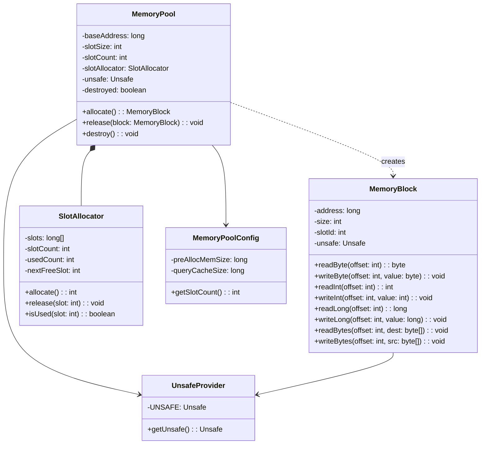
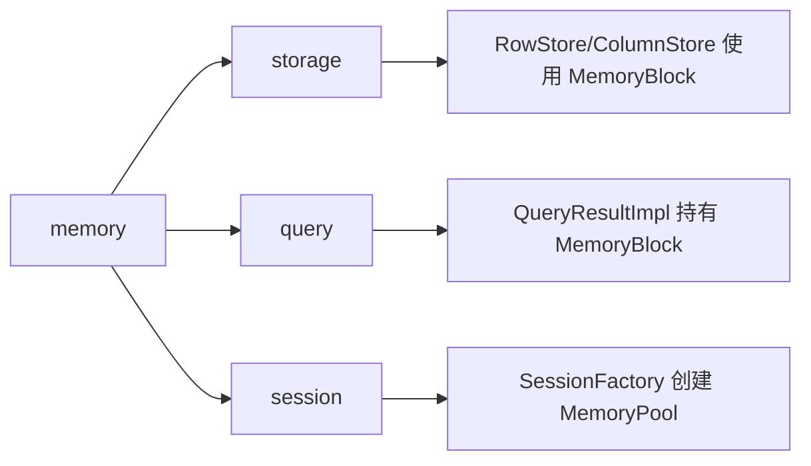

# memory 模块设计文档

## 概述

memory 模块是 jrdb 的核心基础设施，负责堆外内存的管理。通过 `sun.misc.Unsafe` 直接操作堆外内存，避免 GC 压力，实现高性能的内存池管理。

## 类结构



## 核心类详解

### UnsafeProvider

单例提供 `Unsafe` 实例，通过反射获取 `theUnsafe` 字段。

```java
public final class UnsafeProvider {
    private static final Unsafe UNSAFE;
    
    static {
        Field field = Unsafe.class.getDeclaredField("theUnsafe");
        field.setAccessible(true);
        UNSAFE = (Unsafe) field.get(null);
    }
    
    public static Unsafe getUnsafe() {
        return UNSAFE;
    }
}
```

**设计要点：**
- 静态初始化块确保 Unsafe 实例只获取一次
- 反射绕过 Unsafe 的私有构造器限制
- 全局唯一实例避免重复创建

### MemoryPoolConfig

内存池配置类，使用 Builder 模式。

```java
public class MemoryPoolConfig {
    public static final long DEFAULT_PRE_ALLOC_MEM_SIZE = 256L * 1024 * 1024; // 256MB
    public static final long DEFAULT_QUERY_CACHE_SIZE = 16L * 1024 * 1024;    // 16MB
    
    private final long preAllocMemSize;
    private final long queryCacheSize;
    
    public int getSlotCount() {
        return (int) (preAllocMemSize / queryCacheSize);
    }
}
```

**配置项说明：**
- `preAllocMemSize`: 预分配的总内存大小
- `queryCacheSize`: 每个查询缓存槽位的大小
- `slotCount`: 槽位数量 = 总内存 / 槽位大小

### SlotAllocator

基于位图的槽位分配器，高效管理内存槽位。

```java
public class SlotAllocator {
    private final long[] slots;       // 位图数组
    private final int slotCount;      // 总槽位数
    private int usedCount;            // 已使用数量
    private int nextFreeSlot;         // 下一个可用槽位
    
    public synchronized int allocate() {
        // 从 nextFreeSlot 开始线性查找
        for (int i = 0; i < slotCount; i++) {
            int slot = (startSlot + i) % slotCount;
            if (!isUsed(slot)) {
                markUsed(slot);
                usedCount++;
                nextFreeSlot = (slot + 1) % slotCount;
                return slot;
            }
        }
        throw new IllegalStateException("All slots are used");
    }
    
    public synchronized void release(int slot) {
        markUnused(slot);
        usedCount--;
        if (slot < nextFreeSlot) {
            nextFreeSlot = slot;
        }
    }
    
    private boolean isUsed(int slot) {
        return (slots[slot / 64] & (1L << (slot % 64))) != 0;
    }
}
```

**设计要点：**
- 位图结构：每个 `long` 管理 64 个槽位
- 线性分配：从 `nextFreeSlot` 开始查找，减少搜索开销
- 释放优化：释放的槽位可能成为下一个分配点

### MemoryPool

内存池核心类，管理堆外内存的生命周期。

```java
public class MemoryPool {
    private final long baseAddress;   // 内存基地址
    private final int slotSize;       // 槽位大小
    private final int slotCount;      // 槽位数量
    private final SlotAllocator slotAllocator;
    private final Unsafe unsafe;
    
    public MemoryPool(MemoryPoolConfig config) {
        this.slotSize = (int) config.getQueryCacheSize();
        this.slotCount = config.getSlotCount();
        this.slotAllocator = new SlotAllocator(slotCount);
        this.unsafe = UnsafeProvider.getUnsafe();
        this.baseAddress = unsafe.allocateMemory(config.getPreAllocMemSize());
    }
    
    public synchronized MemoryBlock allocate() {
        int slotId = slotAllocator.allocate();
        long address = baseAddress + (long) slotId * slotSize;
        return new MemoryBlock(address, slotSize, slotId, unsafe);
    }
    
    public synchronized void release(MemoryBlock block) {
        slotAllocator.release(block.getSlotId());
    }
    
    public synchronized void destroy() {
        unsafe.freeMemory(baseAddress);
        destroyed = true;
    }
}
```

**设计要点：**
- 预分配策略：启动时一次性分配，避免运行时分配开销
- 地址计算：`address = baseAddress + slotId * slotSize`
- 线程安全：所有操作加 `synchronized`
- 生命周期管理：`destroy()` 释放内存，之后不可使用

### MemoryBlock

内存块操作类，提供类型安全的读写接口。

```java
public class MemoryBlock {
    private final long address;
    private final int size;
    private final int slotId;
    private final Unsafe unsafe;
    
    public int readInt(int offset) {
        checkOffset(offset, 4);
        return unsafe.getInt(address + offset);
    }
    
    public void writeInt(int offset, int value) {
        checkOffset(offset, 4);
        unsafe.putInt(address + offset, value);
    }
    
    public void writeBytes(int offset, byte[] src) {
        checkOffset(offset, src.length);
        unsafe.copyMemory(src, Unsafe.ARRAY_BYTE_BASE_OFFSET, 
                          null, address + offset, src.length);
    }
    
    // Fast版本：无边界检查，性能优先
    public void writeIntFast(int offset, int value) {
        unsafe.putInt(address + offset, value);
    }
}
```

**设计要点：**
- 边界检查：安全版本验证 offset 有效性
- Fast 方法：跳过检查，用于已知安全的场景
- 内存复制：`copyMemory` 高效搬运字节数组

## 内存布局

```
MemoryPool 内存布局:
┌──────────────────────────────────────────────────────────────┐
│ Slot 0  (slotSize bytes)                                      │
├──────────────────────────────────────────────────────────────┤
│ Slot 1  (slotSize bytes)                                      │
├──────────────────────────────────────────────────────────────┤
│ Slot 2  (slotSize bytes)                                      │
├──────────────────────────────────────────────────────────────┤
│ ...                                                           │
├──────────────────────────────────────────────────────────────┤
│ Slot N  (slotSize bytes)                                      │
└──────────────────────────────────────────────────────────────┘
baseAddress ────────────────────────────────────────────────────►

地址计算公式:
slotAddress = baseAddress + slotId * slotSize
```

## 性能考虑

### 为什么使用堆外内存？

1. **零 GC 压力**：堆外内存不受 JVM GC 管理
2. **稳定内存地址**：避免 GC 移动对象导致的地址变化
3. **大内存支持**：突破 JVM 堆大小限制
4. **直接内存访问**：减少一次 JVM 堆拷贝

### 性能优化策略

1. **预分配**：启动时一次性分配，运行时无分配开销
2. **槽位复用**：释放的槽位可立即重新分配
3. **Fast 方法**：关键路径跳过边界检查
4. **位图管理**：紧凑的位表示，内存占用小

### 线程安全策略

- `MemoryPool` 的 `allocate/release/destroy` 加 `synchronized`
- `SlotAllocator` 的 `allocate/release` 加 `synchronized`
- `MemoryBlock` 的读写方法不加锁（单线程使用场景）

## 扩展点

1. **内存溢出策略**：当所有槽位用尽时的处理策略（ERROR/DROP_OLDEST/DROP_NEWEST）
2. **动态扩展**：支持运行时扩展内存池大小（当前未实现）
3. **内存统计**：增加内存使用率监控接口

## 使用示例

```java
// 创建内存池
MemoryPoolConfig config = MemoryPoolConfig.builder()
    .preAllocMemSize(256 * 1024 * 1024)
    .queryCacheSize(16 * 1024 * 1024)
    .build();
MemoryPool pool = new MemoryPool(config);

// 分配内存块
MemoryBlock block = pool.allocate();
block.writeInt(0, 12345);
block.writeLong(4, 987654321L);

// 读取数据
int intValue = block.readInt(0);
long longValue = block.readLong(4);

// 释放内存块
pool.release(block);

// 销毁内存池
pool.destroy();
```

## 与其他模块的关系

