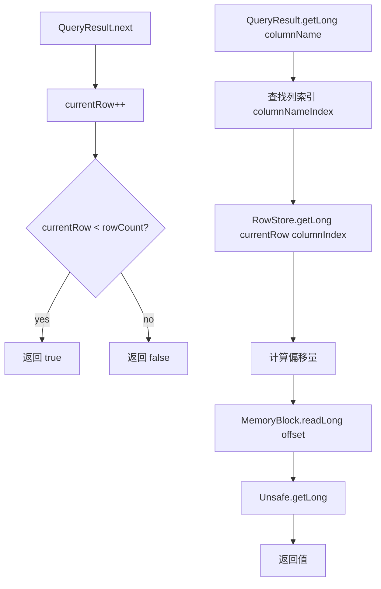
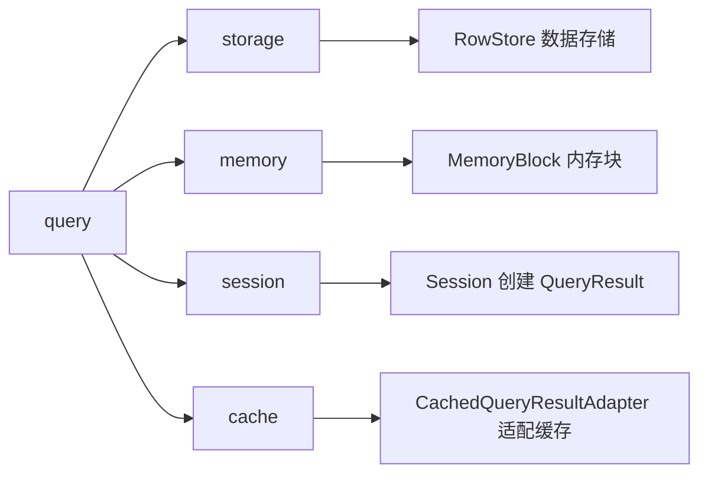

# query 模块设计文档

## 概述

query 模块负责查询结果的封装和访问，提供类型安全的列数据读取接口。通过 `QueryResult` 接口统一返回结果，支持从堆外内存直接读取数据。

## 类结构

```mermaid
classDiagram
    interface QueryResult {
        +getRowCount(): int
        +getColumnCount(): int
        +getColumnName(columnIndex: int): String
        +getInt(columnName: String): int
        +getLong(columnName: String): long
        +getString(columnName: String): String
        +getDouble(columnName: String): double
        +getInt(columnIndex: int): int
        +getLong(columnIndex: int): long
        +getString(columnIndex: int): String
        +getDouble(columnIndex: int): double
        +next(): boolean
        +reset(): void
        +release(): void
        +close(): void
    }
    
    class QueryResultImpl {
        -store: RowStore
        -rowCount: int
        -block: MemoryBlock
        -pool: MemoryPool
        -columnNameIndex: Map
        -currentRow: int
        -closed: boolean
    }
    
    QueryResult <|.. QueryResultImpl
    QueryResultImpl --> RowStore
    QueryResultImpl --> MemoryBlock
    QueryResultImpl --> MemoryPool
```

## 核心类详解

### QueryResult 接口

定义查询结果的基本访问契约。

```java
public interface QueryResult extends AutoCloseable {
    int getRowCount();
    int getColumnCount();
    String getColumnName(int columnIndex);
    
    int getInt(String columnName);
    long getLong(String columnName);
    String getString(String columnName);
    double getDouble(String columnName);
    
    int getInt(int columnIndex);
    long getLong(int columnIndex);
    String getString(int columnIndex);
    double getDouble(int columnIndex);
    
    boolean next();
    void reset();
    void release();
    void close();
}
```

**设计要点：**
- 继承 `AutoCloseable`，支持资源自动释放
- 提供按名称和按索引两种访问方式
- 支持游标式遍历（`next()` 方法）

### QueryResultImpl

查询结果实现类，从堆外内存读取数据。

#### 核心属性

```java
private final RowStore store;              // 行存储引用
private final int rowCount;                // 行数
private final MemoryBlock block;           // 内存块引用
private final MemoryPool pool;             // 内存池引用（用于释放）
private final Map<String, Integer> columnNameIndex;  // 列名到索引映射
private int currentRow;                    // 当前游标位置
private boolean closed;                    // 关闭状态
```

#### 构造器

```java
public QueryResultImpl(RowStore store, int rowCount, MemoryBlock block, MemoryPool pool) {
    this.store = store;
    this.rowCount = rowCount;
    this.block = block;
    this.pool = pool;
    
    // 构建列名索引映射
    this.columnNameIndex = new HashMap<>();
    for (int i = 0; i < store.getColumnCount(); i++) {
        String name = store.getColumnMeta(i).getName();
        columnNameIndex.put(name.toUpperCase(), i);
    }
    
    this.currentRow = -1;
    this.closed = false;
}
```

**设计要点：**
- 列名转大写，支持大小写不敏感查询
- 游标初始位置 -1，需调用 `next()` 后才能访问数据

#### 数据访问实现

```java
// 按列名访问
public long getLong(String columnName) {
    return getLong(getColumnIndex(columnName));
}

// 按索引访问
public long getLong(int columnIndex) {
    return store.getLong(currentRow, columnIndex);
}

private int getColumnIndex(String columnName) {
    Integer index = columnNameIndex.get(columnName.toUpperCase());
    if (index == null) {
        throw new IllegalArgumentException("Unknown column name: " + columnName);
    }
    return index;
}
```

#### 游标操作

```java
public boolean next() {
    currentRow++;
    return currentRow < rowCount;
}

public void reset() {
    currentRow = -1;
}
```

#### 资源释放

```java
public void release() {
    if (pool != null && block != null) {
        pool.release(block);
    }
}

public void close() {
    if (closed) {
        return;
    }
    release();
    closed = true;
}
```

## 数据访问流程



## 内存布局

```
QueryResult 内存视图:
┌──────────────────────────────────────────────────────────────┐
│ RowStore (基于 MemoryBlock)                                   │
├──────────────────────────────────────────────────────────────┤
│ Row 0: [id:8B][name:64B][age:4B][score:8B]...                 │
│ Row 1: [id:8B][name:64B][age:4B][score:8B]...                 │
│ Row 2: [id:8B][name:64B][age:4B][score:8B]...                 │
│ ...                                                           │
│ Row N: [id:8B][name:64B][age:4B][score:8B]...                 │
├──────────────────────────────────────────────────────────────┤
│ currentRow 游标位置                                           │
└──────────────────────────────────────────────────────────────┘

列名索引映射:
columnNameIndex = {
    "ID": 0,
    "NAME": 1,
    "AGE": 2,
    "SCORE": 3
}
```

## 类型安全访问

不同类型调用不同的 RowStore 方法：

| QueryResult 方法 | RowStore 方法 | 数据类型 |
|------------------|---------------|----------|
| `getInt()` | `store.getInt()` | 32位整数 |
| `getLong()` | `store.getLong()` | 64位整数 |
| `getDouble()` | `store.getDouble()` | 64位浮点 |
| `getString()` | `store.getString()` | UTF-8字符串 |

## 与 CachedQueryResultAdapter 的关系

当 L2 缓存命中时，返回 `CachedQueryResultAdapter`，同样实现 `QueryResult` 接口：

```mermaid
classDiagram
    interface QueryResult {
        +getRowCount(): int
        +getColumnCount(): int
        +next(): boolean
        +getLong(columnName: String): long
    }
    
    class QueryResultImpl {
        -store: RowStore
        -block: MemoryBlock
        从堆外内存读取
    }
    
    class CachedQueryResultAdapter {
        -cached: CachedQueryResult
        -currentRow: int
        从堆内存 Map 读取
    }
    
    QueryResult <|.. QueryResultImpl
    QueryResult <|.. CachedQueryResultAdapter
```

两种实现的对比：

| 特性 | QueryResultImpl | CachedQueryResultAdapter |
|------|-----------------|--------------------------|
| 数据来源 | 堆外 MemoryBlock | 堆内 Map |
| 内存管理 | 需要显式释放 | 无需释放 |
| 性能 | 直接内存访问 | 对象访问 |
| 生命周期 | 短暂（查询后释放） | 长期（缓存持久） |

## 使用示例

```java
// 基本使用
QueryResult result = session.query("SELECT id, name FROM users");
while (result.next()) {
    long id = result.getLong("id");
    String name = result.getString("name");
    System.out.println(id + ": " + name);
}
result.close();

// 按索引访问
while (result.next()) {
    long id = result.getLong(0);      // 第0列
    String name = result.getString(1); // 第1列
}

// 重置游标
result.reset();
while (result.next()) {
    // 再次遍历
}

// try-with-resources
try (QueryResult result = session.query(sql)) {
    while (result.next()) {
        // ...
    }
} // 自动调用 close()

// 回调式使用（自动关闭）
User user = session.query(sql, rs -> {
    if (rs.next()) {
        return new User(rs.getLong("id"), rs.getString("name"));
    }
    return null;
});
```

## 设计考虑

### 为什么使用游标模式？

1. **内存效率**：避免一次性加载所有数据到堆内
2. **延迟访问**：用户按需访问，减少不必要的数据读取
3. **兼容性**：类似 JDBC ResultSet 的使用习惯

### 为什么提供两种访问方式？

- **按名称**：更直观，避免列顺序变化导致的错误
- **按索引**：性能更高，跳过名称查找

### 线程安全

`QueryResult` 设计为单线程使用：
- `currentRow` 是非线程安全的游标
- 多线程访问同一结果需要外部同步或创建副本

## 与其他模块的关系

