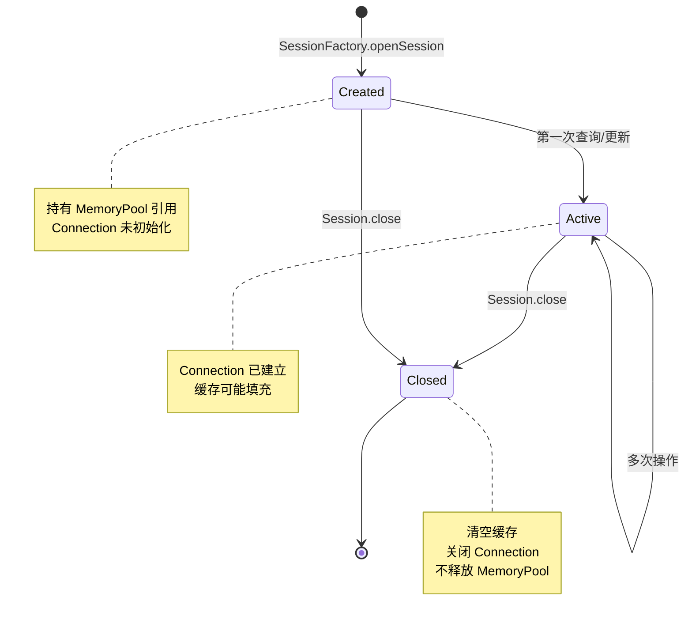
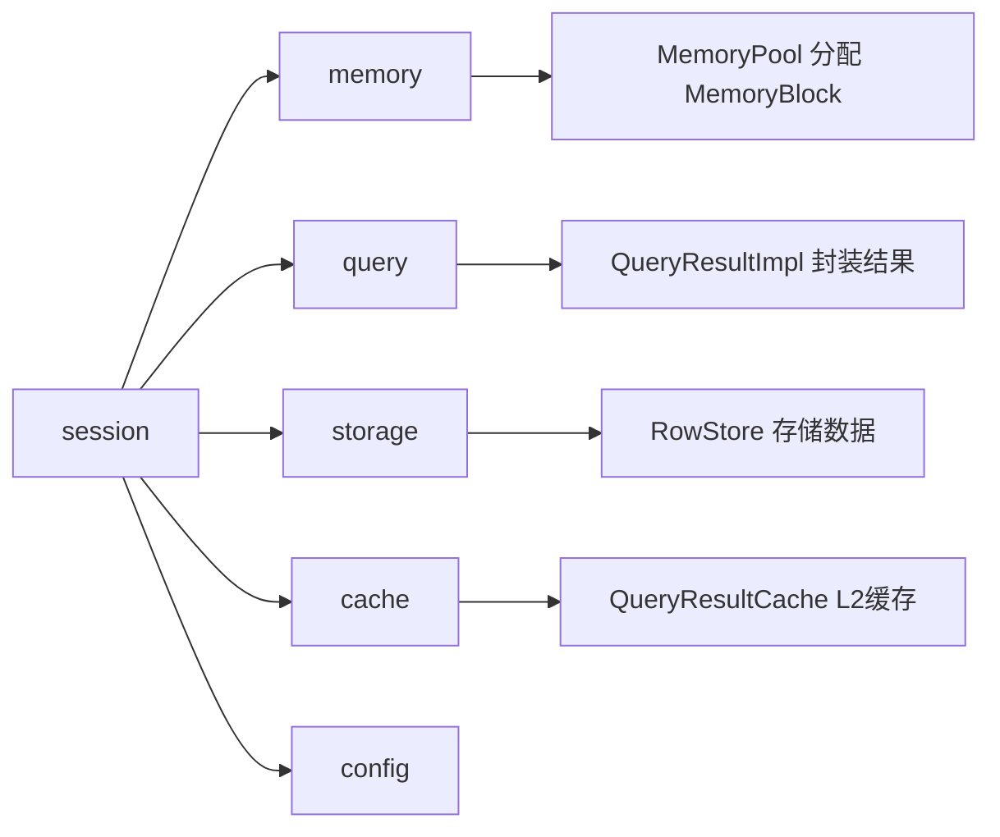

# session 模块设计文档

## 概述

session 模块负责数据库会话的创建和管理，是用户与数据库交互的核心入口。通过 `SessionFactory` 创建 `Session`，提供查询、更新等数据库操作能力。

## 类结构

```mermaid
classDiagram
    interface Session {
        +query(sql: String): QueryResult
        +query(sql: String, params: Object...): QueryResult
        +update(sql: String): int
        +update(sql: String, params: Object...): int
        +batchUpdate(sqls: String...): int[]
        +close(): void
    }
    
    class SessionImpl {
        -memoryPool: MemoryPool
        -config: DbMmapConfig
        -dataSource: DataSource
        -connection: Connection
        -statementCache: Map
        -metaCache: Map
        -resultCache: QueryResultCache
        -cacheLevel: CacheLevel
        -closed: boolean
        +query(sql: String, params: Object...): QueryResult
        +update(sql: String, params: Object...): int
        +clearCache(): void
    }
    
    class SessionFactory {
        -config: DbMmapConfig
        -memoryPool: MemoryPool
        -dataSource: DataSource
        -closed: boolean
        +openSession(): Session
        +close(): void
    }
    
    Session <|.. SessionImpl
    SessionFactory --> SessionImpl : creates
    SessionFactory --> MemoryPool
    SessionFactory --> DbMmapConfig
    SessionImpl --> MemoryPool
    SessionImpl --> DbMmapConfig
    SessionImpl --> QueryResultCache
```

## 核心类详解

### Session 接口

定义会话的基本操作契约。

```java
public interface Session extends AutoCloseable {
    QueryResult query(String sql);
    QueryResult query(String sql, Object... params);
    <T> T query(String sql, Function<QueryResult, T> handler);
    
    int update(String sql);
    int update(String sql, Object... params);
    int[] batchUpdate(String... sqls);
    
    MemoryPool getMemoryPool();
    boolean isClosed();
    void close();
}
```

**设计要点：**
- 继承 `AutoCloseable`，支持 try-with-resources
- 提供带参数和不带参数的查询方法
- 支持回调式查询，自动关闭结果集

### SessionFactory

会话工厂，管理全局资源。

```java
public class SessionFactory {
    private final DbMmapConfig config;
    private final MemoryPool memoryPool;
    private final DataSource dataSource;
    private volatile boolean closed;
    
    public SessionFactory(DbMmapConfig config, DataSource dataSource) {
        this.config = config;
        this.dataSource = dataSource;
        MemoryPoolConfig poolConfig = config.getMemoryPoolConfig();
        this.memoryPool = new MemoryPool(poolConfig);
    }
    
    public Session openSession() {
        if (closed) {
            throw new IllegalStateException("SessionFactory is closed");
        }
        if (dataSource == null) {
            throw new IllegalStateException("DataSource not configured");
        }
        return new SessionImpl(memoryPool, config, dataSource);
    }
    
    public synchronized void close() {
        closed = true;
        memoryPool.destroy();
    }
}
```

**设计要点：**
- 持有全局共享的 `MemoryPool`
- 每次 `openSession` 创建新的 `SessionImpl`
- `close` 时销毁内存池释放资源
- 使用 `volatile` 确保关闭状态的可见性

### SessionImpl

会话实现类，执行具体的数据库操作。

#### 核心属性

```java
private final MemoryPool memoryPool;          // 内存池引用
private final DbMmapConfig config;            // 配置
private final DataSource dataSource;          // 数据源
private Connection connection;                // 当前连接
private final Map<String, PreparedStatement> statementCache;  // Statement缓存
private final Map<String, QueryMeta> metaCache;               // 元数据缓存
private final QueryResultCache resultCache;                   // L2结果缓存
private final CacheLevel cacheLevel;          // 缓存级别
private volatile boolean closed;              // 关闭状态
```

#### 缓存策略

根据 `cacheLevel` 决定缓存行为：

```java
public SessionImpl(...) {
    this.cacheLevel = config.getCacheLevel();
    
    // L1 或 L2 缓存启用时创建缓存
    if (cacheLevel != CacheLevel.NONE) {
        this.statementCache = createLruCache(config.getStatementCacheSize());
        this.metaCache = createLruCache(config.getStatementCacheSize());
    } else {
        this.statementCache = null;
        this.metaCache = null;
    }
    
    // 仅 L2 缓存启用时创建结果缓存
    if (cacheLevel == CacheLevel.L2) {
        this.resultCache = new QueryResultCache(...);
    } else {
        this.resultCache = null;
    }
}
```

#### 查询流程

```java
public QueryResult query(String sql, Object... params) {
    if (closed) {
        throw new IllegalStateException("Session is closed");
    }
    
    // L2 缓存检查
    if (cacheLevel == CacheLevel.L2) {
        CachedQueryResult cached = resultCache.get(sql, params);
        if (cached != null) {
            return new CachedQueryResultAdapter(cached);
        }
    }
    
    // 执行查询
    QueryResult result = executeQuery(sql, params);
    
    // L2 缓存存储
    if (cacheLevel == CacheLevel.L2 && result != null) {
        CachedQueryResult cached = copyResult(result);
        resultCache.put(sql, params, cached);
        result.close();
        return new CachedQueryResultAdapter(cached);
    }
    
    return result;
}
```

#### executeQuery 核心逻辑

```java
private QueryResult executeQuery(String sql, Object... params) {
    Connection conn = getConnection();
    PreparedStatement ps = getOrCreateStatement(sql, conn);
    setParameters(ps, params);
    
    ResultSet rs = ps.executeQuery();
    QueryMeta meta = getOrCreateMeta(sql, rs);
    
    // 分配内存
    MemoryBlock block = memoryPool.allocate();
    RowStore store = new RowStore(block, meta.columns);
    
    // 数据加载
    int rowCount = 0;
    while (rs.next() && rowCount < meta.maxRows) {
        int rowOffset = rowCount * rowSize;
        for (int i = 0; i < colCount; i++) {
            setColumnValueUltraFast(store, rs, rowOffset, colOffset, ...);
        }
        rowCount++;
    }
    
    rs.close();
    
    // 缓存未启用时关闭 Statement
    if (cacheLevel == CacheLevel.NONE) {
        ps.close();
    }
    
    return new QueryResultImpl(store, rowCount, block, memoryPool);
}
```

#### Statement 缓存管理

```java
private PreparedStatement getOrCreateStatement(String sql, Connection conn) {
    if (cacheLevel == CacheLevel.NONE) {
        return conn.prepareStatement(sql);
    }
    
    PreparedStatement ps = statementCache.get(sql);
    if (ps == null || ps.isClosed()) {
        ps = conn.prepareStatement(sql);
        statementCache.put(sql, ps);
    } else {
        ps.clearParameters();
    }
    return ps;
}
```

#### LRU 缓存实现

```java
private <K, V> Map<K, V> createLruCache(int maxSize) {
    return new LinkedHashMap<K, V>(maxSize, 0.75f, true) {
        @Override
        protected boolean removeEldestEntry(Map.Entry<K, V> eldest) {
            return size() > maxSize;
        }
    };
}
```

**设计要点：**
- `LinkedHashMap` 的 `accessOrder=true` 实现 LRU
- 超过 `maxSize` 时自动移除最老条目
- 简单高效，无需引入外部依赖

## QueryMeta 内部结构

```java
private static class QueryMeta {
    final List<ColumnMeta> columns;  // 列元数据
    final int rowSize;               // 每行字节大小
    final int maxRows;               // 最大行数
    
    QueryMeta(List<ColumnMeta> columns, int slotSize) {
        this.columns = columns;
        this.rowSize = columns.stream().mapToInt(ColumnMeta::getSize).sum();
        this.maxRows = slotSize / Math.max(rowSize, 1);
    }
}
```

**计算说明：**
- `rowSize` = 所有列大小之和
- `maxRows` = 槽位大小 / 行大小

## 列大小映射

```java
private int getColumnSize(int sqlType) {
    switch (sqlType) {
        case Types.INTEGER: case Types.DATE: case Types.FLOAT: return 4;
        case Types.BIGINT: case Types.TIMESTAMP: case Types.DOUBLE: return 8;
        case Types.BOOLEAN: case Types.TINYINT: return 1;
        case Types.SMALLINT: return 2;
        case Types.VARCHAR: case Types.CHAR: return 64;
        case Types.DECIMAL: case Types.NUMERIC: return 32;
        default: return 32;
    }
}
```

## 数据类型转换

```java
private void setColumnValueUltraFast(RowStore store, ResultSet rs, ...) {
    switch (sqlType) {
        case Types.INTEGER:
            store.setIntFast(rowOffset, colOffset, rs.getInt(rsColIndex));
            break;
        case Types.BIGINT:
            store.setLongFast(rowOffset, colOffset, rs.getLong(rsColIndex));
            break;
        case Types.VARCHAR:
            store.setStringFast(rowOffset, colOffset, rs.getString(rsColIndex), maxSize);
            break;
        case Types.DOUBLE:
            store.setDoubleFast(rowOffset, colOffset, rs.getDouble(rsColIndex));
            break;
        case Types.TIMESTAMP:
            Timestamp ts = rs.getTimestamp(rsColIndex);
            store.setLongFast(rowOffset, colOffset, ts != null ? ts.getTime() : 0L);
            break;
        // ... 其他类型
    }
}
```

## 会话生命周期



## 性能优化

### 连接管理

- 懒加载：首次操作时才获取 Connection
- 单连接：Session 内复用同一 Connection

### Statement 缓存

- 避免：每次创建 PreparedStatement 的开销
- 清理：调用 `clearParameters()` 准备下次使用
- 监控：检测 `isClosed()` 状态

### 元数据缓存

- 列信息：首次查询时解析 ResultSetMetaData
- 复用：相同 SQL 的后续查询直接使用缓存

### Fast 方法调用

- 跳过边界检查：`setIntFast`、`setLongFast` 等
- 预计算偏移：rowOffset 和 colOffset 在循环外计算

## 使用示例

```java
// 创建 SessionFactory
DbMmapConfig config = DbMmapConfig.builder()
    .cacheLevel(CacheLevel.L2)
    .statementCacheSize(256)
    .build();
SessionFactory factory = new SessionFactory(config, dataSource);

// 使用 Session
try (Session session = factory.openSession()) {
    // 查询
    QueryResult result = session.query("SELECT * FROM users WHERE id = ?", 1);
    while (result.next()) {
        long id = result.getLong("id");
        String name = result.getString("name");
    }
    result.close();
    
    // 回调式查询（自动关闭）
    User user = session.query("SELECT * FROM users WHERE id = ?", rs -> {
        if (rs.next()) {
            return new User(rs.getLong("id"), rs.getString("name"));
        }
        return null;
    });
    
    // 更新
    int affected = session.update("UPDATE users SET name = ? WHERE id = ?", "newName", 1);
    
    // 批量更新
    int[] results = session.batchUpdate(
        "INSERT INTO users (name) VALUES ('a')",
        "INSERT INTO users (name) VALUES ('b')"
    );
}

// 关闭工厂
factory.close();
```

## 与其他模块的关系

