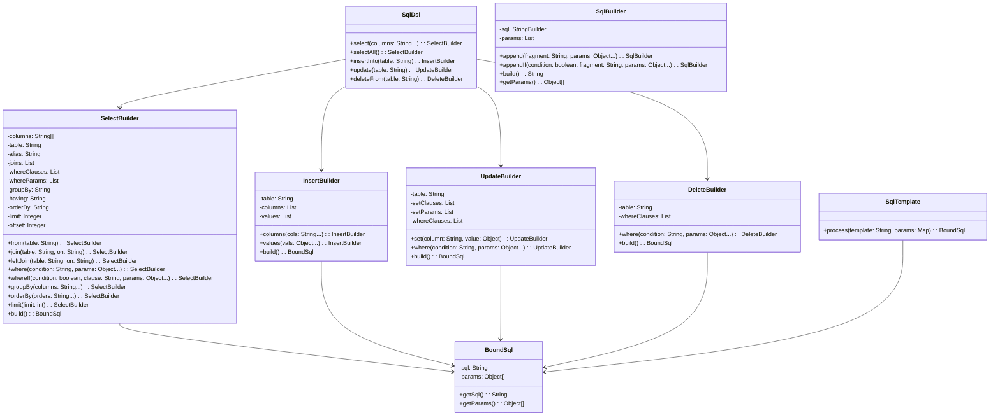
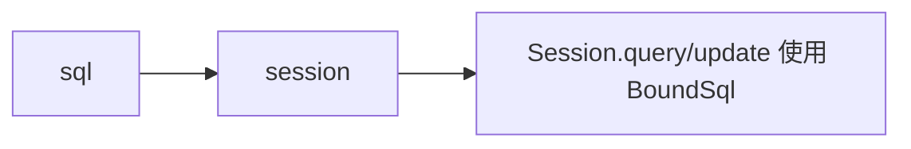

# sql 模块设计文档

## 概述

sql 模块提供 SQL 构建能力，包括 DSL 风格的 SQL 构建、模板式 SQL 处理和参数绑定。支持 SELECT、INSERT、UPDATE、DELETE 等操作的流式构建。

## 类结构



## 核心类详解

### BoundSql

绑定 SQL，包含最终 SQL 和参数数组。

```java
public class BoundSql {
    private final String sql;
    private final Object[] params;
    
    public BoundSql(String sql, Object[] params) {
        this.sql = sql;
        this.params = params != null ? params : new Object[0];
    }
    
    public String getSql() { return sql; }
    public Object[] getParams() { return params; }
}
```

**设计要点：**
- 不可变对象，SQL 和参数确定后不可修改
- 参数默认空数组，避免 null 问题

### SqlDsl

DSL 入口类，提供静态方法创建各类 Builder。

```java
public class SqlDsl {
    public static SelectBuilder select(String... columns) {
        return new SelectBuilder(columns);
    }
    
    public static SelectBuilder selectAll() {
        return new SelectBuilder();
    }
    
    public static InsertBuilder insertInto(String table) {
        return new InsertBuilder(table);
    }
    
    public static UpdateBuilder update(String table) {
        return new UpdateBuilder(table);
    }
    
    public static DeleteBuilder deleteFrom(String table) {
        return new DeleteBuilder(table);
    }
}
```

### SelectBuilder

SELECT 语句构建器，支持完整的 SELECT 语法。

```java
public class SelectBuilder {
    private String[] columns;
    private String table;
    private String alias;
    private final List<String> joins = new ArrayList<>();
    private final List<String> whereClauses = new ArrayList<>();
    private final List<Object> whereParams = new ArrayList<>();
    private String groupBy;
    private String having;
    private final List<Object> havingParams = new ArrayList<>();
    private String orderBy;
    private Integer limit;
    private Integer offset;
    
    public SelectBuilder from(String table) {
        this.table = table;
        return this;
    }
    
    public SelectBuilder join(String table, String on) {
        joins.add("JOIN " + table + " ON " + on);
        return this;
    }
    
    public SelectBuilder where(String condition, Object... params) {
        whereClauses.add(condition);
        whereParams.addAll(Arrays.asList(params));
        return this;
    }
    
    public SelectBuilder whereIf(boolean condition, String clause, Object... params) {
        if (condition) {
            where(clause, params);
        }
        return this;
    }
    
    public BoundSql build() {
        StringBuilder sql = new StringBuilder("SELECT ");
        List<Object> allParams = new ArrayList<>();
        
        sql.append(columns == null || columns.length == 0 ? "*" : String.join(", ", columns));
        sql.append(" FROM ").append(table);
        
        if (alias != null) sql.append(" ").append(alias);
        for (String join : joins) sql.append(" ").append(join);
        
        if (!whereClauses.isEmpty()) {
            sql.append(" WHERE ").append(String.join(" AND ", whereClauses));
            allParams.addAll(whereParams);
        }
        
        if (groupBy != null) sql.append(" GROUP BY ").append(groupBy);
        if (having != null) {
            sql.append(" HAVING ").append(having);
            allParams.addAll(havingParams);
        }
        if (orderBy != null) sql.append(" ORDER BY ").append(orderBy);
        if (limit != null) sql.append(" LIMIT ").append(limit);
        if (offset != null) sql.append(" OFFSET ").append(offset);
        
        return new BoundSql(sql.toString(), allParams.toArray());
    }
}
```

### SqlBuilder

通用 SQL 构建器，用于自由拼接 SQL。

```java
public class SqlBuilder {
    private final StringBuilder sql = new StringBuilder();
    private final List<Object> params = new ArrayList<>();
    
    public static SqlBuilder create() {
        return new SqlBuilder();
    }
    
    public SqlBuilder append(String fragment, Object... params) {
        if (sql.length() > 0 && !fragment.startsWith(" ")) {
            sql.append(" ");
        }
        sql.append(fragment);
        this.params.addAll(Arrays.asList(params));
        return this;
    }
    
    public SqlBuilder appendIf(boolean condition, String fragment, Object... params) {
        if (condition) {
            append(fragment, params);
        }
        return this;
    }
    
    public String build() { return sql.toString(); }
    public Object[] getParams() { return params.toArray(); }
}
```

### SqlTemplate

模板 SQL 处理器，支持参数占位符。

```java
public class SqlTemplate {
    private static final Pattern PARAM_PATTERN = Pattern.compile("#\\{([^}]+)\\}");
    private static final Pattern REPLACE_PATTERN = Pattern.compile("\\$\\{([^}]+)\\}");
    
    public static BoundSql process(String template, Map<String, Object> params) {
        List<Object> paramList = new ArrayList<>();
        
        // ${} 直接替换
        Matcher replaceMatcher = REPLACE_PATTERN.matcher(template);
        StringBuffer sb = new StringBuffer();
        while (replaceMatcher.find()) {
            String key = replaceMatcher.group(1);
            Object value = params.get(key);
            replaceMatcher.appendReplacement(sb, value != null ? value.toString() : "");
        }
        replaceMatcher.appendTail(sb);
        
        // #{} 转为参数占位符
        String sql = sb.toString();
        Matcher paramMatcher = PARAM_PATTERN.matcher(sql);
        sb = new StringBuffer();
        while (paramMatcher.find()) {
            String key = paramMatcher.group(1);
            Object value = getParamValue(params, key);
            paramList.add(value);
            paramMatcher.appendReplacement(sb, "?");
        }
        paramMatcher.appendTail(sb);
        
        return new BoundSql(sb.toString(), paramList.toArray());
    }
    
    private static Object getParamValue(Map<String, Object> params, String key) {
        String[] parts = key.split("\\.");
        Object value = params.get(parts[0]);
        // 支持嵌套属性访问 user.name
        for (int i = 1; i < parts.length && value != null; i++) {
            Field field = value.getClass().getDeclaredField(parts[i]);
            field.setAccessible(true);
            value = field.get(value);
        }
        return value;
    }
}
```

**模板语法：**
- `${key}`: 直接替换为字符串值
- `#{key}`: 转为参数占位符 `?`
- `#{obj.field}`: 支持嵌套属性访问

## 使用示例

### DSL 风格构建

```java
// SELECT
BoundSql select = SqlDsl.select("id", "name", "age")
    .from("user")
    .where("id > ?", 10)
    .whereIf(name != null, "name LIKE ?", name)
    .orderBy("id DESC")
    .limit(10)
    .build();

// sql: SELECT id, name, age FROM user WHERE id > ? ORDER BY id DESC LIMIT 10
// params: [10]

// INSERT
BoundSql insert = SqlDsl.insertInto("user")
    .columns("id", "name", "age")
    .values(1L, "Alice", 30)
    .build();

// sql: INSERT INTO user (id, name, age) VALUES (?, ?, ?)
// params: [1L, "Alice", 30]

// UPDATE
BoundSql update = SqlDsl.update("user")
    .set("name", "Bob")
    .set("age", 35)
    .where("id = ?", 1L)
    .build();

// sql: UPDATE user SET name = ?, age = ? WHERE id = ?
// params: ["Bob", 35, 1L]

// DELETE
BoundSql delete = SqlDsl.deleteFrom("user")
    .where("id = ?", 1L)
    .build();

// sql: DELETE FROM user WHERE id = ?
// params: [1L]
```

### 自由拼接

```java
SqlBuilder builder = SqlBuilder.create()
    .append("SELECT * FROM user")
    .appendIf(active, "WHERE status = ?", "active")
    .append("ORDER BY id");

String sql = builder.build();
Object[] params = builder.getParams();
```

### 模板处理

```java
String template = "SELECT * FROM ${table} WHERE id = #{id} AND name = #{user.name}";
Map<String, Object> params = new HashMap<>();
params.put("table", "user");
params.put("id", 1L);
params.put("user", new User(1L, "Alice"));

BoundSql boundSql = SqlTemplate.process(template, params);
// sql: SELECT * FROM user WHERE id = ? AND name = ?
// params: [1L, "Alice"]
```

### JOIN 操作

```java
BoundSql sql = SqlDsl.select("u.id", "u.name", "o.order_id")
    .from("user", "u")
    .join("order o", "u.id = o.user_id")
    .leftJoin("product p", "o.product_id = p.id")
    .where("u.status = ?", "active")
    .build();

// sql: SELECT u.id, u.name, o.order_id FROM user u 
//      JOIN order o ON u.id = o.user_id 
//      LEFT JOIN product p ON o.product_id = p.id 
//      WHERE u.status = ?
```

## 设计考虑

### 为什么使用 Builder 模式？

1. **流式 API**：链式调用，代码可读性好
2. **类型安全**：编译期检查方法调用
3. **可扩展**：新增语法只需添加 Builder 方法

### 为什么分离 SQL 和参数？

1. **PreparedStatement 支持**：参数绑定避免 SQL 注入
2. **缓存友好**：相同 SQL 不同参数可复用 PreparedStatement
3. **日志友好**：可独立记录 SQL 和参数

### whereIf 的设计目的

```java
.whereIf(name != null, "name LIKE ?", name)
```

避免条件拼接的繁琐判断：

```java
// 传统方式
if (name != null) {
    builder.where("name LIKE ?", name);
}
```

## 与其他模块的关系

