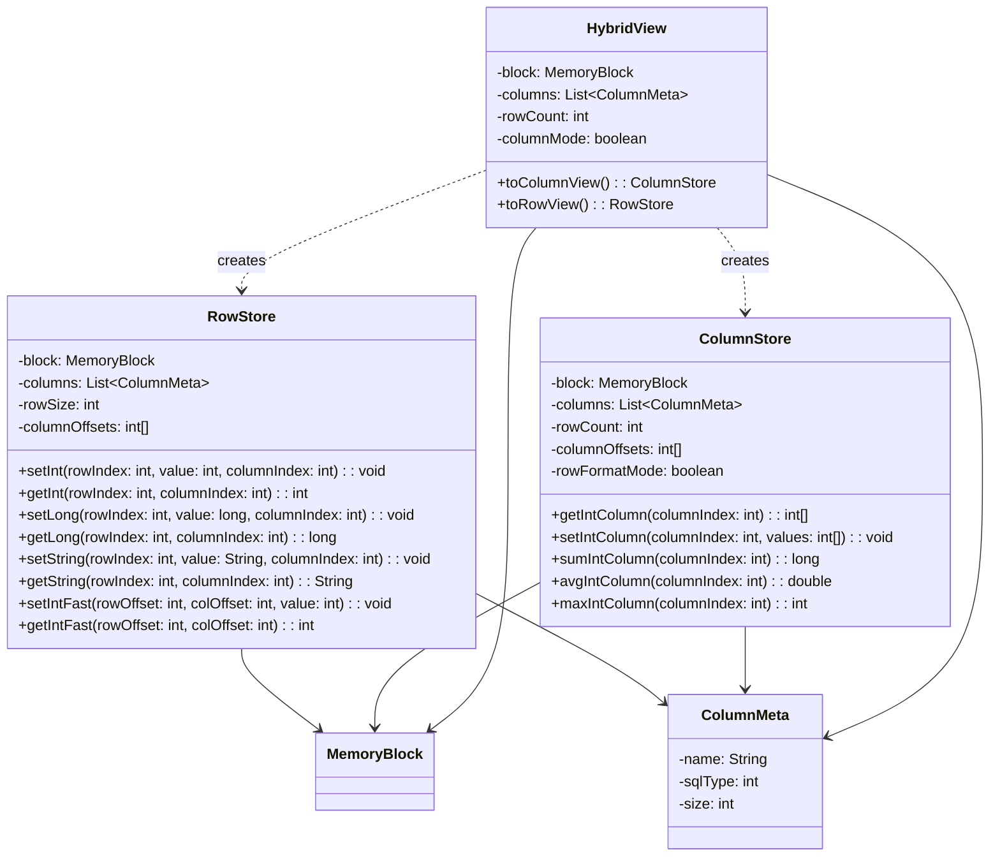
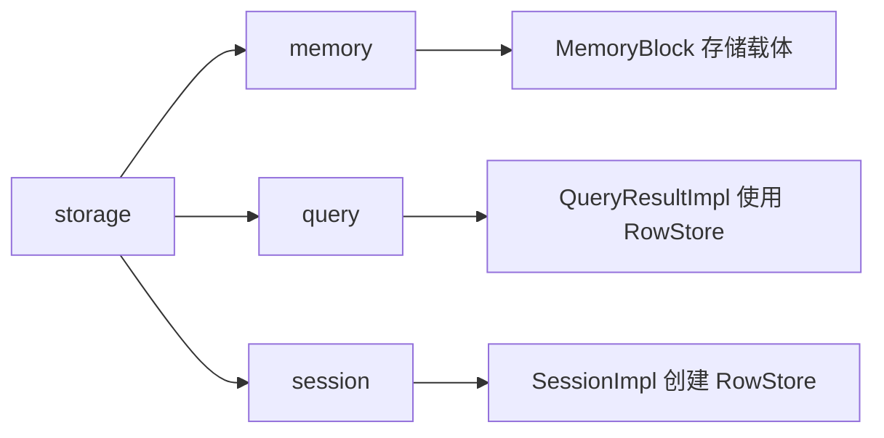

# storage 模块设计文档

## 概述

storage 模块负责数据在堆外内存中的存储格式和访问方式。提供行式存储（RowStore）和列式存储（ColumnStore）两种方案，以及混合视图（HybridView）支持动态切换。

## 类结构



## 核心类详解

### ColumnMeta

列元数据，描述单列的基本属性。

```java
public class ColumnMeta {
    private final String name;    // 列名
    private final int sqlType;    // SQL类型（Types.XXX）
    private final int size;       // 字节大小
    
    public ColumnMeta(String name, int sqlType, int size) {
        this.name = name;
        this.sqlType = sqlType;
        this.size = size;
    }
}
```

**类型大小映射：**
| SQL 类型 | Java 类型 | 字节大小 |
|----------|-----------|----------|
| INTEGER | int | 4 |
| BIGINT | long | 8 |
| DOUBLE | double | 8 |
| VARCHAR | String | 64（固定） |
| BOOLEAN | boolean | 1 |
| TIMESTAMP | long | 8 |

### RowStore

行式存储，按行组织数据。

#### 内存布局

```
RowStore 内存布局:
┌──────────────────────────────────────────────────────────────┐
│ Row 0: [Col0: size0][Col1: size1][Col2: size2]...[ColN]       │
│ Row 1: [Col0: size0][Col1: size1][Col2: size2]...[ColN]       │
│ Row 2: [Col0: size0][Col1: size1][Col2: size2]...[ColN]       │
│ ...                                                           │
│ Row M: [Col0: size0][Col1: size1][Col2: size2]...[ColN]       │
└──────────────────────────────────────────────────────────────┘

rowSize = Σ columnSizes
offset(rowIndex, colIndex) = rowIndex * rowSize + columnOffsets[colIndex]
```

#### 初始化

```java
public RowStore(MemoryBlock block, List<ColumnMeta> columns) {
    this.block = block;
    this.columns = columns;
    this.columnOffsets = new int[columns.size()];
    
    int offset = 0;
    for (int i = 0; i < columns.size(); i++) {
        columnOffsets[i] = offset;
        offset += columns.get(i).getSize();
    }
    this.rowSize = offset;
}
```

#### 数据读写（安全版本）

```java
public int getInt(int rowIndex, int columnIndex) {
    validateBounds(rowIndex, columnIndex);
    int offset = getOffset(rowIndex, columnIndex);
    return block.readInt(offset);
}

public void setLong(int rowIndex, long value, int columnIndex) {
    validateBounds(rowIndex, columnIndex);
    int offset = getOffset(rowIndex, columnIndex);
    block.writeLong(offset, value);
}

private int getOffset(int rowIndex, int columnIndex) {
    return rowIndex * rowSize + columnOffsets[columnIndex];
}
```

#### 数据读写（Fast版本）

```java
public void setIntFast(int rowOffset, int colOffset, int value) {
    block.writeIntFast(rowOffset + colOffset, value);
}

public long getLongFast(int rowOffset, int colOffset) {
    return block.readLongFast(rowOffset + colOffset);
}
```

**设计要点：**
- Fast 方法接收预先计算的偏移量
- 调用方需确保偏移量有效
- 用于高频场景，性能优先

#### 字符串存储

```java
public void setString(int rowIndex, String value, int columnIndex) {
    int offset = getOffset(rowIndex, columnIndex);
    int maxSize = columns.get(columnIndex).getSize();
    
    if (value == null) {
        block.writeInt(offset, 0);
        return;
    }
    
    byte[] bytes = value.getBytes(StandardCharsets.UTF_8);
    int len = Math.min(bytes.length, maxSize - 4);  // 前4字节存长度
    block.writeInt(offset, len);
    block.writeBytes(offset + 4, bytes);
}

public String getString(int rowIndex, int columnIndex) {
    int offset = rowIndex * rowSize + columnOffsets[columnIndex];
    int len = block.readInt(offset);
    if (len == 0) return null;
    
    byte[] bytes = new byte[len];
    block.readBytes(offset + 4, bytes);
    return new String(bytes, StandardCharsets.UTF_8);
}
```

**字符串格式：**
```
┌──────────────────────────────────────────┐
│ [len: 4B][string bytes: maxSize-4B]       │
└──────────────────────────────────────────┘
len = 字符串字节长度（UTF-8编码）
```

### ColumnStore

列式存储，按列组织数据，优化分析查询。

#### 内存布局

```
ColumnStore 内存布局（列格式）:
┌──────────────────────────────────────────────────────────────┐
│ Col 0: [Row0: size0][Row1: size0][Row2: size0]...[RowM]       │
│ Col 1: [Row0: size1][Row1: size1][Row2: size1]...[RowM]       │
│ Col 2: [Row0: size2][Row1: size2][Row2: size2]...[RowM]       │
│ ...                                                           │
│ Col N: [Row0: sizeN][Row1: sizeN][Row2: sizeN]...[RowM]       │
└──────────────────────────────────────────────────────────────┘

colOffset[i] = Σ (rowCount * columnSizes[j]) for j < i
```

#### 偏移量计算

```java
public int[] calculateColumnOffsets() {
    int[] offsets = new int[columns.size()];
    
    if (rowFormatMode) {
        // 行格式：计算列在每行内的偏移
        int offset = 0;
        for (int i = 0; i < columns.size(); i++) {
            offsets[i] = offset;
            offset += columns.get(i).getSize();
        }
    } else {
        // 列格式：计算每列数据区的起始偏移
        int offset = 0;
        for (int i = 0; i < columns.size(); i++) {
            offsets[i] = offset;
            offset += rowCount * columns.get(i).getSize();
        }
    }
    return offsets;
}
```

#### 列数据访问

```java
public int[] getIntColumn(int columnIndex) {
    validateColumnIndex(columnIndex);
    int[] values = new int[rowCount];
    int colOffset = columnOffsets[columnIndex];
    int colSize = columns.get(columnIndex).getSize();
    
    if (rowFormatMode) {
        // 从行格式内存读取
        for (int i = 0; i < rowCount; i++) {
            values[i] = block.readInt(i * rowSize + colOffset);
        }
    } else {
        // 从列格式内存读取
        for (int i = 0; i < rowCount; i++) {
            values[i] = block.readInt(colOffset + i * colSize);
        }
    }
    return values;
}
```

#### 聚合操作

```java
public long sumIntColumn(int columnIndex) {
    int[] values = getIntColumn(columnIndex);
    long sum = 0;
    for (int v : values) {
        sum += v;
    }
    return sum;
}

public double avgIntColumn(int columnIndex) {
    long sum = sumIntColumn(columnIndex);
    return (double) sum / rowCount;
}

public int maxIntColumn(int columnIndex) {
    int[] values = getIntColumn(columnIndex);
    int max = values[0];
    for (int i = 1; i < values.length; i++) {
        if (values[i] > max) max = values[i];
    }
    return max;
}
```

### HybridView

混合视图，支持行式和列式模式切换。

```java
public class HybridView {
    private final MemoryBlock block;
    private final List<ColumnMeta> columns;
    private final int rowCount;
    private boolean columnMode;
    
    public ColumnStore toColumnView() {
        columnMode = true;
        return new ColumnStore(block, columns, rowCount, true);  // rowFormatMode=true
    }
    
    public RowStore toRowView() {
        columnMode = false;
        return new RowStore(block, columns);
    }
    
    public boolean isColumnMode() {
        return columnMode;
    }
}
```

**设计要点：**
- 数据实际存储在行格式
- `ColumnStore` 的 `rowFormatMode=true` 表示从行格式读取列数据
- 模式切换不涉及数据转换，只是视图改变

## 存储格式对比

| 特性 | RowStore | ColumnStore |
|------|----------|-------------|
| 内存布局 | 行连续 | 列连续 |
| 适用场景 | OLTP、点查询 | OLAP、聚合查询 |
| 缓存效率 | 行数据局部性好 | 列数据局部性好 |
| 插入性能 | 高（一次写入） | 低（多次定位） |
| 聚合性能 | 低（跨行跳跃） | 高（列连续） |

## 设计考虑

### 为什么默认使用行式存储？

1. **OLTP 场景**：大多数数据库查询是按行访问
2. **兼容性**：与 JDBC ResultSet 的行为一致
3. **写入效率**：单行数据连续写入，内存访问高效

### 列式存储的优化

1. **聚合查询**：`sumIntColumn` 一次性读取整列数据
2. **压缩潜力**：列内数据类型一致，便于压缩
3. **向量化**：支持 SIMD 优化（未来扩展）

### Fast 方法的使用场景

```java
// SessionImpl 中的高频使用
while (rs.next() && rowCount < maxRows) {
    int rowOffset = rowCount * rowSize;       // 外部预计算
    for (int i = 0; i < colCount; i++) {
        int colOffset = store.getColumnOffset(i);  // 外部预计算
        setColumnValueUltraFast(store, rs, rowOffset, colOffset, ...);
    }
    rowCount++;
}
```

## 使用示例

```java
// RowStore 使用
MemoryBlock block = pool.allocate();
List<ColumnMeta> columns = Arrays.asList(
    new ColumnMeta("id", Types.BIGINT, 8),
    new ColumnMeta("name", Types.VARCHAR, 64)
);
RowStore store = new RowStore(block, columns);

store.setLong(0, 1L, 0);       // 第0行，第0列
store.setString(0, "Alice", 1); // 第0行，第1列

long id = store.getLong(0, 0);
String name = store.getString(0, 1);

// ColumnStore 使用（分析查询）
ColumnStore colStore = new ColumnStore(block, columns, 1000);
int[] ids = colStore.getIntColumn(0);
long sum = colStore.sumIntColumn(0);
double avg = colStore.avgIntColumn(0);

// HybridView 切换
HybridView view = new HybridView(block, columns, 1000);
RowStore rowView = view.toRowView();      // 行模式
ColumnStore colView = view.toColumnView(); // 列模式
```

## 与其他模块的关系

