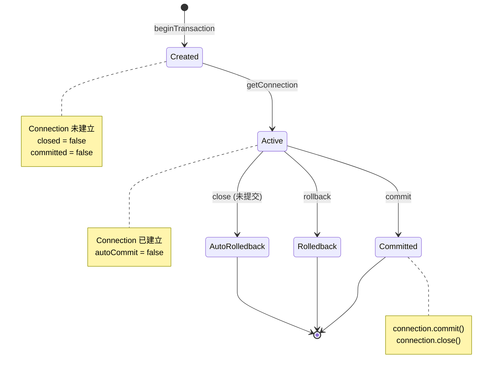
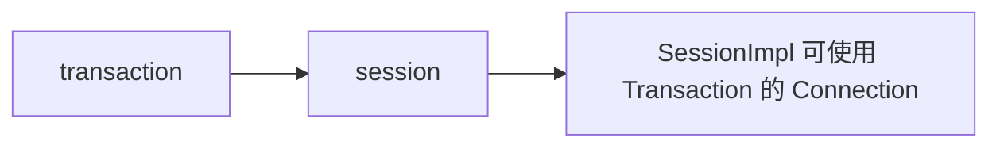

# transaction 模块设计文档

## 概述

transaction 模块提供数据库事务管理能力，支持显式事务控制和自动事务管理。通过 `TransactionManager` 管理事务生命周期，提供编程式事务 API。

## 类结构

```mermaid
classDiagram
    interface Transaction {
        +getConnection(): Connection
        +commit(): void
        +rollback(): void
        +close(): void
        +isClosed(): boolean
    }
    
    class TransactionImpl {
        -dataSource: DataSource
        -connection: Connection
        -closed: boolean
        -committed: boolean
        +getConnection(): Connection
        +commit(): void
        +rollback(): void
        +close(): void
    }
    
    class TransactionManager {
        -dataSource: DataSource
        +beginTransaction(): Transaction
        +executeInTransaction(function: Function): T
        +runInTransaction(callback: TransactionCallback): void
    }
    
    interface TransactionCallback {
        +execute(tx: Transaction): void
    }
    
    Transaction <|.. TransactionImpl
    TransactionManager --> TransactionImpl : creates
    TransactionImpl --> DataSource
```

## 核心类详解

### Transaction 接口

定义事务的基本操作契约。

```java
public interface Transaction extends AutoCloseable {
    Connection getConnection() throws SQLException;
    void commit() throws SQLException;
    void rollback() throws SQLException;
    void close() throws SQLException;
    boolean isClosed();
}
```

**设计要点：**
- 继承 `AutoCloseable`，支持 try-with-resources
- 懒加载 Connection，首次调用时才获取

### TransactionImpl

事务实现类，管理单个事务的生命周期。

```java
public class TransactionImpl implements Transaction {
    private final DataSource dataSource;
    private Connection connection;
    private boolean closed;
    private boolean committed;
    
    public TransactionImpl(DataSource dataSource) {
        this.dataSource = dataSource;
        this.closed = false;
        this.committed = false;
    }
    
    @Override
    public Connection getConnection() throws SQLException {
        if (closed) {
            throw new SQLException("Transaction is closed");
        }
        if (connection == null) {
            connection = dataSource.getConnection();
            connection.setAutoCommit(false);  // 关闭自动提交
        }
        return connection;
    }
    
    @Override
    public void commit() throws SQLException {
        if (closed) return;
        if (connection != null) {
            connection.commit();
            committed = true;
            connection.close();
        }
        closed = true;
    }
    
    @Override
    public void rollback() throws SQLException {
        if (closed) return;
        if (connection != null) {
            connection.rollback();
            connection.close();
        }
        closed = true;
    }
    
    @Override
    public void close() throws SQLException {
        if (closed) return;
        if (connection != null && !committed) {
            connection.rollback();  // 未提交时自动回滚
            connection.close();
        } else if (connection != null) {
            connection.close();
        }
        closed = true;
    }
}
```

**设计要点：**
- 懒加载 Connection：首次 `getConnection()` 时才建立连接
- 自动回滚：`close()` 时如果未提交则自动回滚
- 安全关闭：多次调用 `close()` 只执行一次

### TransactionManager

事务管理器，创建和管理事务。

```java
public class TransactionManager {
    private final DataSource dataSource;
    
    public TransactionManager(DataSource dataSource) {
        this.dataSource = dataSource;
    }
    
    public Transaction beginTransaction() {
        return new TransactionImpl(dataSource);
    }
    
    public <T> T executeInTransaction(Function<Transaction, T> function) throws SQLException {
        Transaction tx = beginTransaction();
        try {
            T result = function.apply(tx);
            tx.commit();
            return result;
        } catch (Exception e) {
            tx.rollback();
            if (e instanceof SQLException) {
                throw (SQLException) e;
            }
            throw new SQLException("Transaction failed", e);
        }
    }
    
    public void runInTransaction(TransactionCallback callback) throws SQLException {
        Transaction tx = beginTransaction();
        try {
            callback.execute(tx);
            tx.commit();
        } catch (SQLException e) {
            tx.rollback();
            throw e;
        } catch (Exception e) {
            tx.rollback();
            throw new SQLException("Transaction failed", e);
        }
    }
}
```

**设计要点：**
- 自动事务管理：`executeInTransaction` 自动提交/回滚
- 异常处理：任何异常都会触发回滚
- 返回值支持：`executeInTransaction` 支持返回结果

### TransactionCallback

事务回调接口。

```java
public interface TransactionCallback {
    void execute(Transaction tx) throws SQLException;
}
```

## 事务生命周期



## 使用示例

### 显式事务控制

```java
TransactionManager tm = new TransactionManager(dataSource);

try (Transaction tx = tm.beginTransaction()) {
    Connection conn = tx.getConnection();
    
    // 执行操作
    PreparedStatement ps1 = conn.prepareStatement("INSERT INTO user ...");
    ps1.executeUpdate();
    
    PreparedStatement ps2 = conn.prepareStatement("UPDATE account ...");
    ps2.executeUpdate();
    
    tx.commit();  // 显式提交
} // 未提交时自动回滚
```

### 自动事务管理（带返回值）

```java
Long userId = tm.executeInTransaction(tx -> {
    Connection conn = tx.getConnection();
    
    PreparedStatement ps = conn.prepareStatement(
        "INSERT INTO user (name) VALUES (?)", 
        Statement.RETURN_GENERATED_KEYS);
    ps.setString(1, "Alice");
    ps.executeUpdate();
    
    ResultSet rs = ps.getGeneratedKeys();
    if (rs.next()) {
        return rs.getLong(1);
    }
    return null;
});
// 自动提交，异常时自动回滚
```

### 自动事务管理（回调式）

```java
tm.runInTransaction(tx -> {
    Connection conn = tx.getConnection();
    
    // 执行多个操作
    conn.prepareStatement("INSERT INTO user ...").executeUpdate();
    conn.prepareStatement("UPDATE account ...").executeUpdate();
});
// 自动提交，异常时自动回滚
```

## 设计考虑

### 为什么使用懒加载 Connection？

1. **资源效率**：事务开始时不立即占用连接
2. **灵活性**：允许创建事务但不实际使用
3. **兼容性**：类似 Spring 的 TransactionTemplate 行为

### 为什么 close() 时自动回滚？

防止忘记提交导致的数据不一致：

```java
try (Transaction tx = tm.beginTransaction()) {
    // 执行操作
    // 忘记调用 commit()
} // close() 自动回滚，确保数据一致性
```

### executeInTransaction 的异常处理

```java
public <T> T executeInTransaction(Function<Transaction, T> function) throws SQLException {
    Transaction tx = beginTransaction();
    try {
        T result = function.apply(tx);
        tx.commit();   // 成功时提交
        return result;
    } catch (Exception e) {
        tx.rollback();  // 异常时回滚
        throw new SQLException("Transaction failed", e);
    }
}
```

**设计要点：**
- 任何异常（包括 RuntimeException）都会回滚
- 异常被包装为 SQLException 抛出

## 与其他模块的关系



**当前关系：**
- Transaction 和 Session 独立使用
- 未来可整合：Session 支持 Transactional Session