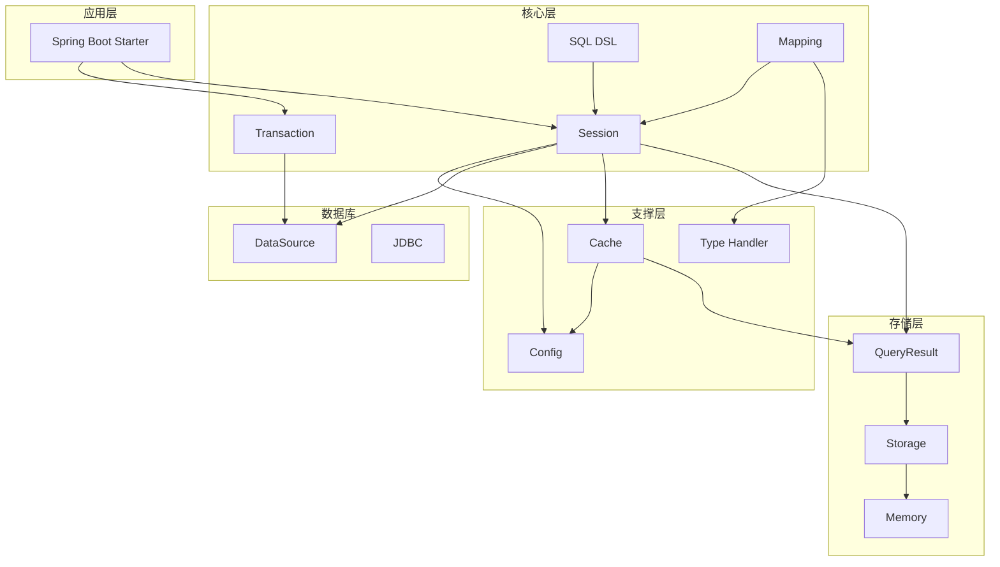
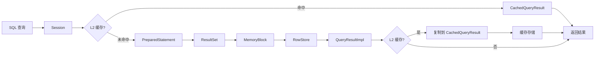

# jrdb 全局设计文档

## 项目概述

jrdb 是一个高性能数据库映射框架，核心特点是使用堆外内存（Off-Heap Memory）存储查询结果，通过 `sun.misc.Unsafe` 直接操作内存，避免 GC 压力，提供极致的查询性能。

## 架构总览



## 模块划分

### 核心模块

| 模块 | 职责 | 核心类 |
|------|------|--------|
| memory | 堆外内存管理 | MemoryPool, MemoryBlock, SlotAllocator |
| session | 数据库会话管理 | Session, SessionImpl, SessionFactory |
| query | 查询结果封装 | QueryResult, QueryResultImpl |
| storage | 数据存储格式 | RowStore, ColumnStore, HybridView |
| mapping | 实体映射 | MapperRegistry, EntityMapper, MapperClassGenerator |
| sql | SQL 构建 | SqlDsl, BoundSql, SqlTemplate |
| cache | 查询缓存 | QueryResultCache, CachedQueryResult |
| config | 配置管理 | JrdbConfig, CacheLevel |
| transaction | 事务管理 | TransactionManager, Transaction |
| type | 类型处理 | TypeHandler, TypeHandlerRegistry |

### 辅助模块

| 模块 | 职责 |
|------|------|
| jdbc | JDBC 辅助工具 |
| jrdb-spring-boot-starter | Spring Boot 自动配置 |

## 数据流架构



## 核心设计决策

### 1. 堆外内存存储

**决策：** 使用 `sun.misc.Unsafe` 分配和管理堆外内存

**理由：**
- 避免大对象对 GC 的影响
- 稳定的内存地址，适合高性能读写
- 突破 JVM 堆大小限制
- 支持更大的内存空间

**代价：**
- 需要手动管理内存释放
- 失去 JVM 的安全检查
- 调试难度增加

### 2. 内存池化设计

**决策：** 预分配内存池 + 槽位管理

**理由：**
- 避免运行时内存分配开销
- 固定大小槽位简化管理
- 位图快速分配/释放

**实现：**
- `SlotAllocator` 使用位图管理槽位
- `MemoryPool` 维护基地址
- 每个 `MemoryBlock` 对应一个槽位

### 3. ASM 字节码生成

**决策：** 使用 ASM 动态生成 EntityMapper 实现类

**理由：**
- 避免反射的性能开销
- 生成直接调用 setter 的字节码
- JVM 可优化为内联调用

**实现：**
- `MapperClassGenerator` 生成字节码
- `MapperClassLoader` 加载生成的类
- `MapperRegistry` 缓存 mapper 实例

### 4. 两级缓存设计

**决策：** L1（Statement 缓存）+ L2（结果缓存）

**理由：**
- L1 减少 PreparedStatement 创建开销
- L2 避免重复查询数据库
- 灵活配置适应不同场景

**实现：**
- L1: `LinkedHashMap` 实现 LRU
- L2: Guava Cache 提供容量限制和过期

### 5. 行式存储优先

**决策：** 默认使用 RowStore，可选 ColumnStore

**理由：**
- OLTP 场景按行访问更常见
- 与 JDBC ResultSet 行为一致
- 写入性能更高

**实现：**
- `RowStore` 按行存储数据
- `ColumnStore` 支持聚合查询
- `HybridView` 支持动态切换

## 性能优化策略

### 内存访问优化

| 策略 | 实现位置 | 效果 |
|------|----------|------|
| Fast 方法 | MemoryBlock, RowStore | 跳过边界检查 |
| 预计算偏移 | SessionImpl | 减少循环内计算 |
| 直接内存访问 | Unsafe | 避免 JVM 堆拷贝 |

### 缓存优化

| 策略 | 实现位置 | 效果 |
|------|----------|------|
| PreparedStatement 缓存 | SessionImpl | 减少对象创建 |
| Meta 缓存 | SessionImpl | 避免重复解析 |
| 结果缓存 | QueryResultCache | 避免重复查询 |

### 并发优化

| 策略 | 实现位置 | 效果 |
|------|----------|------|
| ConcurrentHashMap | MapperRegistry | 线程安全缓存 |
| volatile 状态 | SessionFactory | 可见性保证 |
| synchronized 方法 | MemoryPool | 安全分配释放 |

## 扩展点设计

### 1. TypeHandler 扩展

```java
public interface TypeHandler<T> {
    T getResult(ResultSet rs, String columnName) throws SQLException;
    void setParameter(PreparedStatement ps, int i, T parameter) throws SQLException;
}

// 注册自定义处理器
typeHandlerRegistry.register(MyType.class, new MyTypeHandler());
```

### 2. NameStrategy 扩展

```java
public interface NameStrategy {
    String fieldNameToColumnName(String fieldName);
}

// 配置自定义策略
mappingConfig.setNameStrategy(new MyNameStrategy());
```

### 3. 溢出策略扩展（预留）

```java
public enum OverflowStrategy {
    ERROR,       // 当前实现
    DROP_OLDEST, // 未来扩展
    DROP_NEWEST  // 未来扩展
}
```

## 与主流框架对比

| 特性 | jrdb | MyBatis | Hibernate |
|------|--------|---------|-----------|
| 内存模型 | 堆外内存 | 堆内存 | 堆内存 |
| GC 影响 | 低 | 中 | 高 |
| 映射方式 | ASM 字节码 | 反射/代理 | 反射/代理 |
| 缓存级别 | L1 + L2 | 一级 + 二级 | 一级 + 二级 |
| SQL 构建 | DSL | XML/注解 | HQL/Criteria |

## 未来规划

### 短期

- [ ] 完善溢出策略实现
- [ ] 增加连接池集成
- [ ] 完善 Spring Boot Starter

### 中期

- [ ] 支持更多数据库类型
- [ ] 增加异步查询支持
- [ ] 优化内存碎片问题

### 长期

- [ ] 支持分布式缓存
- [ ] 增加读写分离支持
- [ ] 提供监控指标

## 技术栈

- **Java 8+**
- **ASM 9**: 字节码生成
- **Guava Cache**: L2 缓存实现
- **SLF4J**: 日志门面
- **Spring Boot** (可选): 自动配置